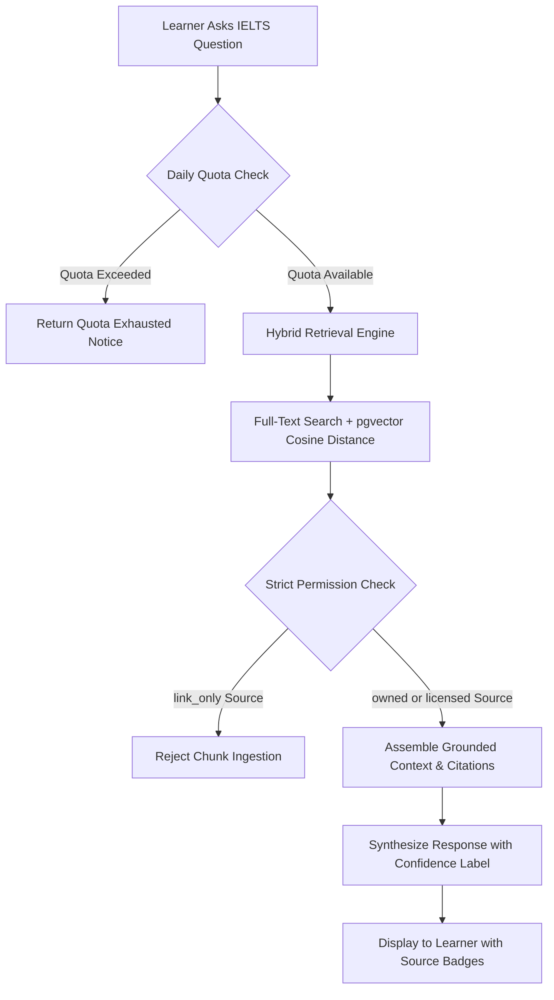

# BandBloom IELTS — Smart Computer-Delivered IELTS Preparation SaaS

> **Official Repository Documentation**  
> **Architecture Version:** 2.2 (Full-Stack Next.js 16 + PostgreSQL/pgvector Backend + Student Portal)  
> **Framework:** Next.js 16 (App Router, Turbopack) &bull; React 19 &bull; TypeScript 5 &bull; Tailwind CSS v4  
> **Database:** PostgreSQL 16+ with `pgvector` &bull; Redis 7 &bull; Native `pg` Connection Pooling  
> **Python Service Layer:** Python 3.10+ &bull; SQLAlchemy 2.0 &bull; Alembic  
> **Repository:** [https://github.com/hasinjubaier/BandBloom.git](https://github.com/hasinjubaier/BandBloom.git)

---

## Table of Contents

1. [Project Overview](#1-project-overview)
2. [Features](#2-features)
3. [Technology Stack](#3-technology-stack)
4. [Project Architecture](#4-project-architecture)
5. [Project Directory Structure](#5-project-directory-structure)
6. [Prerequisites](#6-prerequisites)
7. [Installation and Local Development](#7-installation-and-local-development)
8. [Environment Variables](#8-environment-variables)
9. [Application Routes & Backend APIs](#9-application-routes--backend-apis)
10. [Authentication, Middleware & Session Architecture](#10-authentication-middleware--session-architecture)
11. [Database and Data Model](#11-database-and-data-model)
12. [Centralized Backend Services & Scoring Engine](#12-centralized-backend-services--scoring-engine)
13. [AI Tutor and Grounding Architecture](#13-ai-tutor-and-grounding-architecture)
14. [Testing and Code Quality](#14-testing-and-code-quality)
15. [Deployment](#15-deployment)
16. [Troubleshooting & Known Gotchas](#16-troubleshooting--known-gotchas)
17. [Security, Ethics & Privacy](#17-security-ethics--privacy)
18. [Contribution Guidelines](#18-contribution-guidelines)
19. [License and Legal Attribution](#19-license-and-legal-attribution)

---

## 1. Project Overview

**BandBloom IELTS** is a full-stack computer-delivered IELTS preparation platform built for candidates preparing for the **IELTS Academic** and **IELTS General Training** examinations.

### The Problem
Traditional IELTS preparation suffers from three acute pain points:
1. **Ergonomic Shock on Test Day**: The vast majority of candidates take the official computer-delivered IELTS (CD-IELTS) test, but practice using paper textbooks. On exam day, they encounter split-screen reading passages, rigid question navigation matrices, and server-authoritative countdown timers.
2. **Subjective & Slow Grading**: Writing and Speaking assessments often take days or weeks for human tutors to score, offering generic advice rather than actionable diagnostic breakdown against official band criteria.
3. **Hallucinated Guidance & Scoring Rumors**: Free online test materials frequently propagate unsupported scoring myths and hallucinated explanations without citing verified test specifications.

### The Solution
BandBloom reproduces the ergonomics of the official computer-delivered IELTS exam environment. It pairs rigorous simulation with immediate diagnostic AI evaluations grounded in official specifications, mathematical Section 5.3 band rounding rules, a personal mistake notebook, spaced repetition vocabulary, a centralized student portal, and a bilingual interface tailored for global learners.

### Current Implementation Status
- **Full-Stack Application Core**: Production-ready Next.js 16 App Router application compiled with Turbopack, supporting **45 compiled routes** (25 static pages, 2 partial prerender dynamic routes, and 18 dynamic server API endpoints) guarded by edge middleware.
- **Dedicated Student Portal**: [`PortalShell.tsx`](file:///d:/Project/IELTS%20SaaS/apps/web/src/components/portal/PortalShell.tsx) providing a unified 14-item navigation suite across Overview, Core IELTS Skills, AI & Learning Tools, and Account management, complete with fixed desktop sidebar, mobile drawer, band goal tracking, and safe logout flow.
- **Edge Middleware & Security**: [`middleware.ts`](file:///d:/Project/IELTS%20SaaS/apps/web/src/middleware.ts) protecting all student portal routes and APIs, preventing unauthenticated access, sanitizing open redirects with [`redirect.ts`](file:///d:/Project/IELTS%20SaaS/apps/web/src/lib/redirect.ts), and redirecting authenticated users to their dashboard.
- **Backend Service Layer**: Modular server architecture in [`apps/web/src/server/services/`](file:///d:/Project/IELTS%20SaaS/apps/web/src/server/services/) comprising 8 dedicated domain services: `mock.service.ts`, `dashboard.service.ts`, `notebook.service.ts`, `study-plan.service.ts`, `vocabulary.service.ts`, `tutor.service.ts`, `profile.service.ts`, and `session.service.ts`.
- **Database Architecture**: Comprehensive PostgreSQL 16 schema consisting of **24 normalized relational tables** across 4 migration scripts, `pgvector` semantic vector indexing, connection pooling with slow-query profiling, and Docker Compose orchestration.
- **Python SQLAlchemy Model Suite**: Parallel declarative models in [`apps/api/src/db/models/`](file:///d:/Project/IELTS%20SaaS/apps/api/src/db/models/) with Alembic migration scaffolding and unit tests (`tests/test_database.py`).
- **Design System & Aesthetics**: Tailored IELTS education theme featuring pale teal canvases (`#F4FAF8`), rich navy typography (`#123C3A`), primary brand mint accents (`#25A995`), dark/light themes, and WCAG 2.1 AA compliant UI components.
- **Automated Verification**: End-to-end integration and unit test suite validating Section 5.3 scoring math, database stored function parity, bcrypt authentication, one-active-attempt invariants, and RAG permission gating.

---

## 2. Features

### All Four IELTS Skill Modules
- **Reading**: Split-screen dual-pane viewer displaying academic reading passages alongside the question matrix. Supports authentic question formats:
  - True / False / Not Given & Yes / No / Not Given
  - Matching Headings & Information Location
  - Sentence Completion, Summary Completion & Diagram Labeling
- **Listening**: Audio controller with time-synchronized audio playback, official exam-paced pauses, and real-time form-filling inputs.
- **Writing**: Task 1 (academic graphs / general letters) and Task 2 (discursive essays) simulator with live word counters, distraction-free text editor, and grading breakdowns against official criteria:
  - *Task Achievement / Task Response (TA/TR)*
  - *Coherence & Cohesion (CC)*
  - *Lexical Resource (LR)*
  - *Grammatical Range & Accuracy (GRA)*
- **Speaking**: 3-part interactive interview simulation:
  - *Part 1*: Everyday familiar topics
  - *Part 2*: Long turn cue-card with an automated 1-minute preparation countdown timer and 2-minute recording window
  - *Part 3*: In-depth two-way abstract discussion
  - Built-in audio recorder with transparent microphone permissions and consent gates.

### Dedicated Student Portal ([`PortalShell.tsx`](file:///d:/Project/IELTS%20SaaS/apps/web/src/components/portal/PortalShell.tsx))
- **Unified Navigation Hub**: Organizes platform features into 4 logical groups:
  - **Overview**: Dashboard (`/dashboard`), Study Plan (`/study-plan`), Practice Hub (`/practice`), Mock Test Centre (`/mock-centre`).
  - **Core IELTS Skills**: Dynamic skill pages (`/skills/[skill]`) for Reading, Listening, Writing, and Speaking with tips, criteria, and practice drill shortcuts.
  - **AI & Learning Tools**: AI Tutor (`/tutor`), Vocabulary Bank (`/vocabulary`), Mistake Notebook (`/notebook`), Lessons (`/lessons`), Results & Progress (`/results`).
  - **Account**: Target & Profile Settings (`/settings`).
- **Student Status Header**: Displays target band goal, days remaining until exam, current study streak, quick score calculator modal, theme toggle, and authenticated user dropdown.
- **Responsive Mobile Drawer**: Off-canvas slide-out navigation for mobile and tablet viewports with backdrop blur.

### Computer-Delivered Exam Simulation (CD-IELTS)
- **Authentic Test Environment**: Dedicated `/mock-centre/exam` route that delivers section-based CD-IELTS tests.
- **Ergonomic Question Navigation**: Question matrix with answered, unanswered, and review flags.
- **Server-Authoritative Countdown Timers**: Prevents client clock tampering; validates deadlines and auto-submits upon expiration.
- **Debounced Auto-Saves**: Real-time answer persistence to `/api/attempts/[id]` (PATCH) guaranteed by PostgreSQL unique conflict resolution.

### Official Band Rounding Engine (Section 5.3)
In strict accordance with official IELTS scoring specifications, the average of the 4 skill component scores is rounded mathematically:
- An average ending in `.25` rounds **UP** to the next half band (e.g., $6.25 \rightarrow 6.5$).
- An average ending in `.75` rounds **UP** to the next whole band (e.g., $6.75 \rightarrow 7.0$).
- Implemented symmetrically across:
  - PostgreSQL stored functions: [`ielts_round_band`](file:///d:/Project/IELTS%20SaaS/infra/migrations/001_initial_schema.sql) and [`ielts_calculate_overall_band`](file:///d:/Project/IELTS%20SaaS/infra/migrations/001_initial_schema.sql)
  - Backend mock service: [`ieltsRoundBand`](file:///d:/Project/IELTS%20SaaS/apps/web/src/server/services/mock.service.ts#L56-L66) and [`ieltsCalculateOverallBand`](file:///d:/Project/IELTS%20SaaS/apps/web/src/server/services/mock.service.ts#L68-L83)
  - Frontend client context: [`roundIELTSBand`](file:///d:/Project/IELTS%20SaaS/apps/web/src/context/ExamContext.tsx)
  - Python model tests: [`py_ielts_round_band`](file:///d:/Project/IELTS%20SaaS/tests/test_database.py#L17-L29)

### Grounded AI Tutor
- Explanations are strictly grounded in official test specifications (e.g. *IELTS Academic Reading Candidate Guide 2026*, *Official Scoring Tables*).
- Responses include source citation badges, evidence labels, and confidence classifications (`supported`, `limited`, `insufficient_evidence`).
- Daily quota tracking enforced via `audit_logs` (default: 25 requests per user/day).

### Personal Mistake Notebook & Spaced Repetition Vocabulary
- **Cognitive Trap Categorization**: Identifies errors by specific tags (*paraphrase miss*, *inference trap*, *keyword trap*, *word limit breach*, *singular/plural error*).
- **Academic Word List (AWL)**: Vocabulary bank organized by CEFR/Band levels (Band 6.0 to 8.5+) with collocation patterns, examples, and mastery toggles (`user_vocabulary_progress`).

### Localization & Accessibility
- **Bilingual Interface**: Instant toggle between English (`en`) and Bengali (`bn`) with zero page reloads via [`LanguageContext.tsx`](file:///d:/Project/IELTS%20SaaS/apps/web/src/context/LanguageContext.tsx).
- **Theme Switcher**: Smooth transitions between crisp light mode and deep teal dark mode (`#0A1C1B`) via [`ThemeContext.tsx`](file:///d:/Project/IELTS%20SaaS/apps/web/src/context/ThemeContext.tsx).
- **WCAG 2.1 AA Compliance**: Semantic HTML, screen-reader status announcements (`aria-live`), and full keyboard navigation.

---

## 3. Technology Stack

| Layer | Technology | Version | Purpose |
| :--- | :--- | :--- | :--- |
| **Framework** | [Next.js](https://nextjs.org) | `16.4.2` | App Router, Turbopack, Partial Prerendering, Edge Middleware |
| **Frontend Library** | [React](https://react.dev) | `19.3.0` | React 19 concurrent features, transitions, actions |
| **Language** | [TypeScript](https://www.typescriptlang.org) | `^5.0.0` | Strict type safety across client and server modules |
| **Styling** | [Tailwind CSS](https://tailwindcss.com) | `^4.0.0` | Modern utility styling with `@tailwindcss/turbopack` |
| **Icons** | [Lucide React](https://lucide.dev) | `^1.60.0` | Consistent, accessible vector icon library |
| **Typography** | `next/font` | Google Geist | Optimized font delivery for Geist Sans and Geist Mono |
| **Database Pool** | [`pg`](https://node-postgres.com/) | `^8.23.1` | Native connection pooling, parameterization, and transaction management |
| **Password Hashing**| [`bcryptjs`](https://www.npmjs.com/package/bcryptjs) | `^3.0.3` | Salted bcrypt password hashing and verification |
| **Database** | [PostgreSQL](https://www.postgresql.org) | `16+` | Relational database with custom scoring triggers and stored procedures |
| **Vector Search** | [pgvector](https://github.com/pgvector/pgvector) | `0.7.0+` | HNSW cosine similarity vector indexing for RAG embeddings |
| **Caching & Queues**| [Redis](https://redis.io) | `7-alpine` | Fast session storage, background worker coordination |
| **Python Service** | [Python](https://www.python.org) & [SQLAlchemy](https://www.sqlalchemy.org) | `3.10+` / `2.0+` | Declarative database models, Alembic migrations, test runner |
| **Containerization**| [Docker Compose](https://docs.docker.com/compose/) | `3.8` | Local database, Redis, and migration orchestration |
| **Backend Testing** | Node.js Test Harness | `v20+` | Automated backend integration and scoring tests |

---

## 4. Project Architecture

The BandBloom codebase is organized as a full-stack monorepo managing the Next.js web application, Python database models and migrations, Docker services, and test suites:

```
BandBloom Monorepo Root
├── apps/
│   ├── web/                   # Next.js Full-Stack App Router Application
│   │   ├── src/
│   │   │   ├── app/           # Client pages & 18 dynamic API route handlers
│   │   │   ├── components/    # UI, Layout, Landing, Auth, and Portal components
│   │   │   ├── context/       # Client state providers (Exam, Language, Theme)
│   │   │   ├── data/          # Seed curriculum, skills config, and translations
│   │   │   ├── hooks/         # Custom navigation, scroll spy, and band hooks
│   │   │   ├── lib/           # Utility helpers (safe redirect engine)
│   │   │   ├── middleware.ts  # Edge route protection & auth gate
│   │   │   └── server/        # Server architecture (Database, Auth, Services)
│   │   │       ├── auth/      # Session management & token hashing
│   │   │       ├── db/        # Connection pooling & transactions
│   │   │       └── services/  # 8 domain business logic services
│   │   └── scripts/           # Maintenance and seed scripts
│   └── api/                   # Python / SQLAlchemy 2.0 Backend Models
│       ├── alembic/           # Alembic database migrations
│       └── src/db/models/     # Declarative relational models
├── infra/
│   ├── docker/                # Docker Compose services (PostgreSQL + pgvector, Redis)
│   └── migrations/            # SQL migration scripts (001 through 004)
├── docs/
│   └── architecture/          # Engineering blueprints & entity specifications
└── tests/                     # Integration test suites (Node.js & Python)
```

### Layout Hierarchy & AppShell Architecture
[`AppShell.tsx`](file:///d:/Project/IELTS%20SaaS/apps/web/src/components/layout/AppShell.tsx) acts as the master layout router, dynamically selecting layout presentation based on pathname:
- **Student Portal Routes (`/dashboard`, `/study-plan`, `/mock-centre`, `/skills/*`, `/tutor`, `/vocabulary`, `/notebook`, `/results`, `/settings`, `/practice`, `/lessons`)**: Wrapped in [`PortalShell.tsx`](file:///d:/Project/IELTS%20SaaS/apps/web/src/components/portal/PortalShell.tsx), providing the 14-link student navigation sidebar, student status top bar, and theme switcher.
- **Authentication Pages (`/login`, `/signup`, `/forgot-password`, `/onboarding`)**: Rendered on a focused minimalist canvas without marketing headers, featuring side illustration banners and form cards.
- **Marketing & Public Pages (`/`, `/test-types`, `/test-day-guide`, `/how-it-works`, `/terms`, `/privacy`, etc.)**: Rendered with [`DisclaimerBanner.tsx`](file:///d:/Project/IELTS%20SaaS/apps/web/src/components/layout/DisclaimerBanner.tsx), [`Navbar.tsx`](file:///d:/Project/IELTS%20SaaS/apps/web/src/components/layout/Navbar.tsx), child page content, and [`Footer.tsx`](file:///d:/Project/IELTS%20SaaS/apps/web/src/components/layout/Footer.tsx).

### Route Protection & Safe Redirects
- [`middleware.ts`](file:///d:/Project/IELTS%20SaaS/apps/web/src/middleware.ts): Protects all student portal routes against unauthenticated access. It verifies the presence of a valid 64-character hex session token in the `bandbloom_session` cookie. Unauthenticated requests to protected pages are redirected to `/login?next=...`. Unauthenticated requests to protected API endpoints return HTTP 401 JSON.
- [`redirect.ts`](file:///d:/Project/IELTS%20SaaS/apps/web/src/lib/redirect.ts): `getSafeRedirectUrl()` sanitizes target URLs, strictly preventing open redirect attacks, protocol-relative bypasses (`//evil.com`), JavaScript/data URI schemes, and redirect loops.

---

## 5. Project Directory Structure

```
d:\Project\IELTS SaaS
├── .agents/
│   └── rules/
│       └── manual-git-workflow.md             # Developer Git staging and commit rules
├── .env.example                               # Canonical environment variable specification
├── package.json                               # Monorepo root package.json (workspaces & test scripts)
├── README.md                                  # Master repository documentation (this file)
│
├── apps/
│   ├── api/                                   # Python / SQLAlchemy Backend Models
│   │   ├── alembic.ini                        # Alembic migration configuration
│   │   ├── alembic/                           # Migration environment scripts
│   │   ├── requirements.txt                   # Python dependencies (FastAPI, SQLAlchemy, pgvector)
│   │   └── src/db/
│   │       ├── base.py                        # Declarative base & mixins
│   │       ├── session.py                     # SQLAlchemy session factory
│   │       └── models/                        # Declarative entity models
│   │           ├── user.py                    # User, Profile, Session, AuthToken, Consent
│   │           ├── exam.py                    # Exam, ExamSection, Attempt, Response, Score, Feedback
│   │           ├── content.py                 # Question, QuestionOption, Lesson
│   │           ├── learning.py                # StudyPlan, MistakeNote, VocabularyItem, UserVocabularyProgress
│   │           ├── media.py                   # MediaAsset, Recording
│   │           ├── rag.py                     # ContentSource, ContentChunk, TutorReport
│   │           └── system.py                  # AIJob, AuditLog
│   │
│   └── web/                                   # Next.js Full-Stack Application
│       ├── package.json                       # Dependencies & Next.js scripts
│       ├── next.config.ts                     # Turbopack & Next.js compiler configuration
│       ├── tsconfig.json                      # TypeScript strict configuration
│       ├── scripts/
│       │   └── seed-passwords.js              # Database password and demo profile seeder
│       ├── public/                            # Static assets (WebP logos, globe maps, illustrations)
│       └── src/
│           ├── middleware.ts                  # Edge authentication & route protection middleware
│           ├── app/                           # App Router routes and API handlers
│           │   ├── page.tsx                   # Marketing landing page
│           │   ├── login/page.tsx             # Dedicated student login route
│           │   ├── signup/page.tsx            # Dedicated registration route
│           │   ├── forgot-password/page.tsx   # Password recovery request route
│           │   ├── onboarding/page.tsx        # 4-step learner onboarding wizard
│           │   ├── dashboard/page.tsx         # Student performance & readiness dashboard
│           │   ├── mock-centre/               # Mock test hub & /exam simulator
│           │   │   ├── page.tsx               # Available mock exam catalog & filter
│           │   │   └── exam/page.tsx          # Full-screen CD-IELTS computer exam simulator
│           │   ├── results/                   # Exam results & progress
│           │   │   ├── page.tsx               # Historical test attempts & performance list
│           │   │   └── [id]/page.tsx          # Diagnostic score report with Section 5.3 breakdown
│           │   ├── skills/[skill]/page.tsx    # Dynamic IELTS skill module (Reading, Listening, Writing, Speaking)
│           │   ├── practice/page.tsx          # Adaptive practice drill hub
│           │   ├── lessons/page.tsx           # Curriculum lesson library sorted by skill and band
│           │   ├── vocabulary/page.tsx        # Academic Word List with spaced repetition mastery
│           │   ├── notebook/page.tsx          # Personal mistake notebook categorized by cognitive trap tags
│           │   ├── study-plan/page.tsx        # Weekly interactive study roadmap
│           │   ├── tutor/page.tsx             # Grounded AI tutor workspace with source citations
│           │   ├── settings/page.tsx          # Student target band, exam date, consents, theme
│           │   ├── how-it-works/page.tsx      # Platform overview & scoring methodology
│           │   ├── test-types/page.tsx        # Academic vs General Training track comparison
│           │   ├── test-day-guide/page.tsx    # CD-IELTS test day room rules and ergonomics
│           │   ├── terms/page.tsx             # Terms of Service
│           │   ├── privacy/page.tsx           # Privacy Policy & audio retention guidelines
│           │   ├── accessibility/page.tsx     # Accessibility statement (WCAG 2.1 AA)
│           │   ├── ai-feedback-policy/page.tsx# AI assessment guidelines & confidence badges
│           │   ├── disclaimer/page.tsx        # Trademark notice & non-affiliation disclaimer
│           │   └── api/                       # 18 Dynamic Server API Route Handlers
│           │       ├── attempts/              # / (GET list, POST start), /[id] (GET score, PATCH save, POST submit)
│           │       ├── auth/                  # /login, /register, /logout, /me, /forgot-password, /reset-password
│           │       ├── dashboard/             # / (GET student dashboard summary)
│           │       ├── exams/                 # / (GET list), /[id] (GET detail)
│           │       ├── health/                # / (GET database connectivity & latency probe)
│           │       ├── lessons/               # / (GET curriculum lessons)
│           │       ├── notebook/              # / (GET mistakes, POST log mistake, PATCH update status)
│           │       ├── profile/               # / (GET profile, PATCH update details & consents)
│           │       ├── study-plan/            # / (GET weekly tasks, PATCH toggle completion)
│           │       ├── tutor/chat/            # / (POST query grounded AI tutor)
│           │       └── vocabulary/            # / (GET deck, POST add custom word, PATCH toggle mastery)
│           ├── components/                    # Modular UI Component Library
│           │   ├── auth/                      # LoginForm, SignupForm, illustrations
│           │   ├── globe/                     # 3D Canvas Globe, Orbit rings, Skill orbit cards
│           │   ├── landing/                   # Hero, SkillLabs, AI Tutor demo, Band Selector, CTA
│           │   ├── layout/                    # AppShell, Navbar, Footer, DisclaimerBanner
│           │   ├── portal/                    # PortalShell (Student Portal sidebar, topbar, drawers)
│           │   └── ui/                        # Button, SkillCard, ScoreCalculatorModal, SectionHeading
│           ├── context/                       # React 19 Context Providers (Exam, Language, Theme)
│           ├── data/                          # translations.ts, mockCurriculum.ts, skillsConfig.ts
│           ├── hooks/                         # useLandingNavigation.ts, useTargetBand.ts
│           ├── lib/                           # redirect.ts (safe open-redirect protection)
│           ├── server/                        # Backend Server Architecture
│           │   ├── auth/                      # session.ts (Bcrypt, SHA-256 tokens, guards)
│           │   ├── db/                        # index.ts (PostgreSQL connection pool, query profiling)
│           │   └── services/                  # 8 Domain Business Logic Services
│           │       ├── dashboard.service.ts   # Aggregated dashboard metrics & radar
│           │       ├── mock.service.ts        # Attempt lifecycle, Section 5.3 scoring, question bank
│           │       ├── notebook.service.ts    # Mistake note management & trap tags
│           │       ├── profile.service.ts     # User profile & versioned GDPR/AI consents
│           │       ├── session.service.ts     # Server session resolution helper
│           │       ├── study-plan.service.ts  # Study plan task scheduling & completion
│           │       ├── tutor.service.ts       # Grounded AI tutor retrieval & responses
│           │       └── vocabulary.service.ts  # Academic vocabulary & Leitner spaced repetition
│           └── types/                         # TypeScript domain interface definitions
│
├── infra/                                     # Infrastructure definitions
│   ├── docker/
│   │   └── docker-compose.yml                 # PostgreSQL 16 (pgvector) & Redis 7 services
│   └── migrations/
│       ├── 001_initial_schema.sql             # 22 core tables, triggers, scoring functions
│       ├── 002_seed_data.sql                  # Academic & GT seed mock exams and questions
│       ├── 003_auth_and_profile_extensions.sql# Sessions, auth_tokens, password_hash, full_name
│       └── 004_vocabulary.sql                 # Vocabulary items, user_vocabulary_progress, seeds
│
├── docs/
│   └── architecture/
│       └── database.md                        # Entity blueprint & scoring specifications
│
└── tests/                                     # Verification test suites
    ├── run_backend_tests.js                   # Node.js backend integration & unit test suite
    ├── run_live_postgres_tests.py             # Python live PostgreSQL test runner
    └── test_database.py                       # Python unit test suite (SQLAlchemy models & rounding)
```

---

## 6. Prerequisites

Ensure your development environment meets the following requirements:

- **Node.js**: `v20.9.0` or higher (Node 20 or Node 22 LTS recommended for Next.js 16).
- **Package Manager**: `npm` `v9.x`+ or `v10.x`+ (monorepo scripts are configured using npm workspaces).
- **Docker & Docker Compose** *(for local database)*: Docker Desktop or Docker Engine v24+.
- **Python** *(for Python database models & unit tests)*: Python `3.10`+ with virtual environment (`.venv`).

---

## 7. Installation and Local Development

### 1. Clone the Repository
```bash
git clone https://github.com/hasinjubaier/BandBloom.git
cd BandBloom
```

### 2. Install Dependencies
Install dependencies across all monorepo workspaces:
```bash
npm install
```

### 3. Configure Environment Variables
Copy the example environment configuration into the web app:
```bash
cp .env.example apps/web/.env.local
```

### 4. Start Local Database Services
Launch PostgreSQL (with `pgvector`) and Redis containers:
```bash
docker compose -f infra/docker/docker-compose.yml up -d
```
*(The Docker Compose file automatically runs all 4 SQL migrations from `infra/migrations/` on first startup via `/docker-entrypoint-initdb.d`)*.

### 5. Apply Database Migrations (Manual / Verification)
If initializing an existing PostgreSQL database instance manually, apply all 4 migration scripts in order:
```bash
# 1. Base schema (22 core tables, triggers, and functions)
docker exec -i bandbloom-postgres psql -U bandbloom_user -d bandbloom_db < infra/migrations/001_initial_schema.sql

# 2. Seed mock exams, sections, questions, and RAG documents
docker exec -i bandbloom-postgres psql -U bandbloom_user -d bandbloom_db < infra/migrations/002_seed_data.sql

# 3. Authentication & session management extensions
docker exec -i bandbloom-postgres psql -U bandbloom_user -d bandbloom_db < infra/migrations/003_auth_and_profile_extensions.sql

# 4. Spaced repetition vocabulary schema & seeds
docker exec -i bandbloom-postgres psql -U bandbloom_user -d bandbloom_db < infra/migrations/004_vocabulary.sql
```

### 6. Seed Demo Account Passwords
Hash and seed credentials for the built-in demo accounts:
```bash
node apps/web/scripts/seed-passwords.js
```
*(Configures password `Password123!` for `student@bandbloom.test` and `admin@bandbloom.test`)*.

### 7. Run Verification Tests
Validate scoring mathematics, stored procedure parity, and database models:
```bash
# Node.js backend integration suite
npm test

# Python model integrity and band rounding tests
.venv\Scripts\python -m unittest tests/test_database.py
```

### 8. Start the Development Server
Launch the Next.js development server powered by Turbopack:
```bash
npm run dev
```
Open **[http://localhost:3000](http://localhost:3000)** in your browser.

### 9. Build for Production
To validate TypeScript types and build the optimized production bundle:
```bash
npm run build
```

---

## 8. Environment Variables

All variables are defined in [`.env.example`](file:///d:/Project/IELTS%20SaaS/.env.example). Never commit real secrets or production credentials to source control.

| Variable Name | Required | Context | Description & Example Value |
| :--- | :---: | :---: | :--- |
| `APP_ENV` | Optional | Server | Runtime environment (`development`, `staging`, `production`) |
| `APP_NAME` | Optional | Shared | Application display identifier (`BandBloom`) |
| `PORT` | Optional | Server | Local web server port (default: `3000` / `8000`) |
| `DEBUG` | Optional | Server | Enable verbose query duration warnings (`True` / `False`) |
| `DATABASE_URL` | Optional | Server | Async PostgreSQL connection string (`postgresql+asyncpg://...`) |
| `SYNC_DATABASE_URL` | Optional | Server | Synchronous PostgreSQL connection string (`postgresql://...`) |
| `PGHOST` | Optional | Server | Hostname for direct PostgreSQL connection (default: `127.0.0.1`) |
| `PGPORT` | Optional | Server | Port for PostgreSQL connection (default: `5432` / `5433`) |
| `PGUSER` | Optional | Server | PostgreSQL username (`bandbloom_user`) |
| `PGPASSWORD` | Optional | Server | PostgreSQL password (`bandbloom_password`) |
| `PGDATABASE` | Optional | Server | Target database name (`bandbloom_db`) |
| `REDIS_URL` | Optional | Server | Redis server connection string (`redis://localhost:6379/0`) |
| `OBJECT_STORAGE_ENDPOINT` | Optional | Server | S3/MinIO endpoint (`http://localhost:9000`) |
| `OBJECT_STORAGE_ACCESS_KEY` | Optional | Server | Object storage access key |
| `OBJECT_STORAGE_SECRET_KEY` | Optional | Server | Object storage secret key |
| `OBJECT_STORAGE_BUCKET` | Optional | Server | Bucket name (`bandbloom-private-media`) |
| `SIGNED_URL_TTL_SECONDS` | Optional | Server | Pre-signed URL expiration in seconds (default: `300`) |
| `LLM_API_KEY` | Optional | Server | AI API key for AI tutor responses |
| `LLM_MODEL` | Optional | Server | Language model identifier (e.g. `gpt-4o-mini`) |
| `EMBEDDING_MODEL` | Optional | Server | Embedding model identifier (`text-embedding-3-small`) |
| `EMBEDDING_DIMENSION` | Optional | Server | Vector embedding dimension size (default: `1536`) |
| `RAG_TOP_K` | Optional | Server | Number of relevant chunks retrieved per query (default: `8`) |
| `RAG_MIN_RELEVANCE` | Optional | Server | Cosine similarity cutoff threshold (default: `0.72`) |
| `MAX_TUTOR_REQUEST_CHARS` | Optional | Server | Character limit for learner prompt inputs (default: `4000`) |
| `TUTOR_PER_USER_DAILY_QUOTA`| Optional | Server | Daily AI prompt limit per learner account (default: `25`) |

---

## 9. Application Routes & Backend APIs

The Next.js application compiles **45 routes** (27 client user interface routes and 18 dynamic server API endpoints) guarded by Edge Middleware:

### User Interface Routes (Pages)

| Route Path | Type | Layout Shell | Description |
| :--- | :---: | :---: | :--- |
| `/` | `Static` | `AppShell` (Marketing) | Main landing page: Hero, 3D Globe, Skill Labs, AI Tutor, Band Calculator |
| `/login` | `Static` | `AppShell` (Auth Canvas) | Dedicated login page with email/password form and return redirect |
| `/signup` | `Static` | `AppShell` (Auth Canvas) | Registration page with password strength meter and terms consent |
| `/forgot-password` | `Static` | `AppShell` (Auth Canvas) | Secure password reset request page with anti-enumeration protection |
| `/onboarding` | `Static` | `AppShell` (Auth Canvas) | 4-step student setup: track selection, target band, exam date, daily goal |
| `/dashboard` | `Static` | `PortalShell` | Student performance dashboard with readiness radar and daily study tasks |
| `/mock-centre` | `Static` | `PortalShell` | Full-length exam catalog and diagnostic test selector |
| `/mock-centre/exam` | `Static` | `PortalShell` | Distraction-free full-screen CD-IELTS computer exam simulator |
| `/results` | `Static` | `PortalShell` | Historical mock test attempts and score progress overview |
| `/results/[id]` | `Partial`| `PortalShell` | Diagnostic score report with Section 5.3 rounding and criteria breakdown |
| `/skills/[skill]` | `Partial`| `PortalShell` | Dynamic skill module (Reading, Listening, Writing, Speaking) with tips and drills |
| `/practice` | `Static` | `PortalShell` | Quick skill drill hub and adaptive practice module selector |
| `/lessons` | `Static` | `PortalShell` | Curriculum lesson library sorted by skill and CEFR band level |
| `/vocabulary` | `Static` | `PortalShell` | Academic Word List & Collocation bank with spaced repetition mastery |
| `/notebook` | `Static` | `PortalShell` | Personal mistake notebook categorizing errors by cognitive trap tags |
| `/study-plan` | `Static` | `PortalShell` | Weekly personalized study roadmap with interactive task checkboxes |
| `/tutor` | `Static` | `PortalShell` | Grounded AI tutor workspace with source citation badges |
| `/settings` | `Static` | `PortalShell` | Student profile settings, target band, exam date, consents, theme |
| `/how-it-works` | `Static` | `AppShell` (Marketing) | Diagnostic assessment workflow and scoring methodology overview |
| `/test-types` | `Static` | `AppShell` (Marketing) | Academic vs General Training track comparison guide |
| `/test-day-guide` | `Static` | `AppShell` (Marketing) | Computer-delivered test room ergonomics, ID requirements, and rules |
| `/terms` | `Static` | `AppShell` (Marketing) | Terms of Service governing platform usage and materials protection |
| `/privacy` | `Static` | `AppShell` (Marketing) | Privacy policy and student audio recording retention guidelines |
| `/accessibility` | `Static` | `AppShell` (Marketing) | Accessibility compliance statement (WCAG 2.1 AA) |
| `/ai-feedback-policy`| `Static` | `AppShell` (Marketing) | AI assessment boundaries, confidence scores, and human review guidelines |
| `/disclaimer` | `Static` | `AppShell` (Marketing) | Trademark notices and official non-affiliation disclaimer |

### Server API Endpoints

| Endpoint | Method | Security | Description |
| :--- | :---: | :---: | :--- |
| [`/api/health`](file:///d:/Project/IELTS%20SaaS/apps/web/src/app/api/health/route.ts) | `GET` | Public | System and PostgreSQL database connectivity probe with latency tracking |
| [`/api/auth/register`](file:///d:/Project/IELTS%20SaaS/apps/web/src/app/api/auth/register/route.ts) | `POST` | Public | Register user with bcrypt hashing, profile setup, and terms consent |
| [`/api/auth/login`](file:///d:/Project/IELTS%20SaaS/apps/web/src/app/api/auth/login/route.ts) | `POST` | Public | Authenticate user, issue SHA-256 session token in HttpOnly cookie |
| [`/api/auth/logout`](file:///d:/Project/IELTS%20SaaS/apps/web/src/app/api/auth/logout/route.ts) | `POST` | Public | Invalidate active session in database and delete session cookie |
| [`/api/auth/me`](file:///d:/Project/IELTS%20SaaS/apps/web/src/app/api/auth/me/route.ts) | `GET` | Optional | Return authenticated user session, profile, and role |
| [`/api/auth/forgot-password`](file:///d:/Project/IELTS%20SaaS/apps/web/src/app/api/auth/forgot-password/route.ts) | `POST` | Public | Generate password reset token with anti-enumeration protection |
| [`/api/auth/reset-password`](file:///d:/Project/IELTS%20SaaS/apps/web/src/app/api/auth/reset-password/route.ts) | `POST` | Public | Verify reset token and update user password hash |
| [`/api/dashboard`](file:///d:/Project/IELTS%20SaaS/apps/web/src/app/api/dashboard/route.ts) | `GET` | Authenticated | Aggregated student dashboard summary (readiness radar, streak, tasks, stats) |
| [`/api/exams`](file:///d:/Project/IELTS%20SaaS/apps/web/src/app/api/exams/route.ts) | `GET` | Public | List available mock exams with section counts and total durations |
| [`/api/exams/[id]`](file:///d:/Project/IELTS%20SaaS/apps/web/src/app/api/exams/[id]/route.ts) | `GET` | Public | Fetch exam details and ordered section breakdown |
| [`/api/attempts`](file:///d:/Project/IELTS%20SaaS/apps/web/src/app/api/attempts/route.ts) | `GET` | Authenticated | List all exam attempts for the authenticated student |
| [`/api/attempts`](file:///d:/Project/IELTS%20SaaS/apps/web/src/app/api/attempts/route.ts) | `POST` | Authenticated | Start or resume active attempt (enforces one-active-attempt rule) |
| [`/api/attempts/[id]`](file:///d:/Project/IELTS%20SaaS/apps/web/src/app/api/attempts/[id]/route.ts) | `GET` | Authenticated | Fetch attempt details, questions, answers, and Section 5.3 results |
| [`/api/attempts/[id]`](file:///d:/Project/IELTS%20SaaS/apps/web/src/app/api/attempts/[id]/route.ts) | `PATCH` | Authenticated | Debounced idempotent autosave of candidate answers |
| [`/api/attempts/[id]`](file:///d:/Project/IELTS%20SaaS/apps/web/src/app/api/attempts/[id]/route.ts) | `POST` | Authenticated | Submit attempt, evaluate objective answers, and compute official band scores |
| [`/api/notebook`](file:///d:/Project/IELTS%20SaaS/apps/web/src/app/api/notebook/route.ts) | `GET` | Authenticated | List mistake notes with skill and retry status filtering |
| [`/api/notebook`](file:///d:/Project/IELTS%20SaaS/apps/web/src/app/api/notebook/route.ts) | `POST` | Authenticated | Create a new mistake note categorized by cognitive trap tag |
| [`/api/notebook`](file:///d:/Project/IELTS%20SaaS/apps/web/src/app/api/notebook/route.ts) | `PATCH` | Authenticated | Update mistake retry mastery status (`pending`, `reviewed`, `mastered`) |
| [`/api/vocabulary`](file:///d:/Project/IELTS%20SaaS/apps/web/src/app/api/vocabulary/route.ts) | `GET` | Authenticated | Fetch academic vocabulary deck with spaced repetition mastery statuses |
| [`/api/vocabulary`](file:///d:/Project/IELTS%20SaaS/apps/web/src/app/api/vocabulary/route.ts) | `POST` | Authenticated | Add a custom vocabulary word with collocation and example sentence |
| [`/api/vocabulary`](file:///d:/Project/IELTS%20SaaS/apps/web/src/app/api/vocabulary/route.ts) | `PATCH` | Authenticated | Update vocabulary mastery level (`learning`, `mastered`) |
| [`/api/study-plan`](file:///d:/Project/IELTS%20SaaS/apps/web/src/app/api/study-plan/route.ts) | `GET` | Authenticated | Fetch active weekly tasks, daily breakdown, and completion progress |
| [`/api/study-plan`](file:///d:/Project/IELTS%20SaaS/apps/web/src/app/api/study-plan/route.ts) | `PATCH` | Authenticated | Toggle task completion status in student study plan |
| [`/api/profile`](file:///d:/Project/IELTS%20SaaS/apps/web/src/app/api/profile/route.ts) | `GET` | Authenticated | Retrieve student profile, target band, exam date, and active consents |
| [`/api/profile`](file:///d:/Project/IELTS%20SaaS/apps/web/src/app/api/profile/route.ts) | `PATCH` | Authenticated | Update student profile details and versioned GDPR/AI consents |
| [`/api/tutor/chat`](file:///d:/Project/IELTS%20SaaS/apps/web/src/app/api/tutor/chat/route.ts) | `POST` | Authenticated | Query grounded AI tutor with source citations and quota enforcement |
| [`/api/lessons`](file:///d:/Project/IELTS%20SaaS/apps/web/src/app/api/lessons/route.ts) | `GET` | Public | List curriculum lessons filtered by skill and CEFR band level |

---

## 10. Authentication, Middleware & Session Architecture

BandBloom implements an enterprise token-based session management system governed by [`session.ts`](file:///d:/Project/IELTS%20SaaS/apps/web/src/server/auth/session.ts), [`middleware.ts`](file:///d:/Project/IELTS%20SaaS/apps/web/src/middleware.ts), and [`redirect.ts`](file:///d:/Project/IELTS%20SaaS/apps/web/src/lib/redirect.ts):

```mermaid
sequenceDiagram
    autonumber
    actor Learner as Learner Browser
    participant MW as Edge Middleware
    participant API as /api/auth/login
    participant Service as session.ts
    participant DB as PostgreSQL (sessions table)

    Learner->>MW: GET /dashboard
    MW->>MW: Check bandbloom_session cookie (64-char hex)
    Note over MW: Missing token -> Redirect /login?next=/dashboard
    MW-->>Learner: 307 Redirect to /login?next=/dashboard

    Learner->>API: POST /api/auth/login { email, password }
    API->>DB: Query user by email
    DB-->>API: User record (password_hash)
    API->>Service: verifyPassword(password, hash)
    Service-->>API: true (bcrypt match)
    API->>Service: createSession(userId, req)
    Note over Service: Generates 32-byte crypto token<br/>Computes SHA-256 hash<br/>Captures IP & User-Agent
    Service->>DB: INSERT INTO sessions (token_hash, expires_at, ip_address, ...)
    DB-->>Service: OK
    Service-->>API: { token, expiresAt }
    API-->>Learner: 200 OK + Set-Cookie: bandbloom_session=<token>; HttpOnly; SameSite=Lax
    Learner->>MW: GET /dashboard (with session cookie)
    MW-->>Learner: 200 OK (Render Dashboard inside PortalShell)
```

### Key Security Invariants
- **Cryptographic Hashing**: Raw session tokens are never stored in the database. Only the SHA-256 hash of the 32-byte token (`token_hash`) is persisted.
- **Bcrypt Password Storage**: Passwords are encrypted with 10 salt rounds via [`hashPassword`](file:///d:/Project/IELTS%20SaaS/apps/web/src/server/auth/session.ts#L18-L21).
- **Session Expiration**: Sessions expire after 7 days by default (`SESSION_EXPIRY_DAYS = 7`).
- **Flexible Token Extraction**: [`extractSessionToken`](file:///d:/Project/IELTS%20SaaS/apps/web/src/server/auth/session.ts#L73-L91) extracts credentials transparently from either the `bandbloom_session` HttpOnly cookie or the `Authorization: Bearer <token>` header.
- **Anti-Enumeration Protection**: Password reset and recovery flows return identical success acknowledgments regardless of whether the submitted email address exists.
- **Safe Open-Redirect Guard**: [`getSafeRedirectUrl`](file:///d:/Project/IELTS%20SaaS/apps/web/src/lib/redirect.ts#L17-L55) strictly validates redirect parameters, disallowing protocol-relative URLs (`//`), scheme injections, and redirect loops.

---

## 11. Database and Data Model

The schema consists of **24 normalized relational tables** defined across 4 sequential migration files in [`infra/migrations/`](file:///d:/Project/IELTS%20SaaS/infra/migrations/):

### Table Breakdown by Domain

1. **Identity & Authentication**:
   - `users`: Core identity, roles (`student`, `tutor`, `admin`), active status, `password_hash`.
   - `profiles`: Student details, `full_name`, test type (`academic` / `general_training`), target band, target date, daily minutes.
   - `sessions`: Active login sessions, `token_hash`, expiration timestamp, client IP, user agent.
   - `auth_tokens`: Password reset and email verification tokens with single-use consumption tracking.
   - `consents`: GDPR/privacy consents (`terms_and_privacy`, `recording`, `ai_training`) with versioning and revocation timestamps.
2. **Mock Exam Engine**:
   - `exams`: Mock exams with title, test type, versioning, and publishing status.
   - `exam_sections`: Ordered skill sections (Reading, Listening, Writing, Speaking) with duration and instructions.
   - `exam_section_questions`: Join table mapping questions to specific exam sections with sequence ordering.
   - `attempts`: Candidate test sessions with status (`in_progress`, `submitted`, `evaluated`), server deadlines, and config snapshots.
   - `responses`: Candidate answers stored as JSONB with unique constraint `(attempt_id, question_id)`.
   - `scores`: Component and overall scores with raw marks and Section 5.3 estimated bands.
   - `feedback`: Detailed diagnostic feedback per skill component with criteria breakdown.
3. **Content Bank**:
   - `lessons`: Curated video and article lessons by skill and target band.
   - `questions`: Reusable question bank items with prompts, types, and context passages.
   - `question_options`: Structured answer choices and official keys for objective items.
4. **Learning & Spaced Repetition**:
   - `study_plans`: Personalized weekly schedules with task lists and completion flags.
   - `mistake_notes`: Error notebook categorized by cognitive trap tags and mastery statuses (`pending`, `reviewed`, `mastered`).
   - `vocabulary_items`: Academic Word List entries with definitions, collocations, and example sentences.
   - `user_vocabulary_progress`: Spaced repetition state, Leitner interval days, and mastery status.
5. **Media & Student Audio**:
   - `media_assets`: System audio and image assets.
   - `recordings`: Candidate speaking audio recording references with consent foreign keys and retention policies.
6. **RAG Knowledge Base & Operations**:
   - `content_sources`: Official documentation sources with strict `permission_status` (`owned`, `licensed`, `link_only`).
   - `content_chunks`: 1536-dimensional semantic vector embeddings (`pgvector`) and full-text search tokens (`fts`).
   - `tutor_reports`: Learner hallucination reports for human audit.
   - `ai_jobs`: Background asynchronous job tracking.
   - `audit_logs`: Audit trail for security actions and daily AI tutor query quota tracking.

### Core Architectural Invariants
- **One-Active-Attempt Rule**: A partial unique index on `attempts(user_id, exam_id) WHERE status = 'in_progress'` prevents concurrent duplicate exam sessions.
- **Idempotent Auto-Saves**: `responses` enforces `UNIQUE (attempt_id, question_id)`, ensuring debounced auto-saves never duplicate database rows.
- **RAG Permission Guard Trigger**: `trg_prevent_chunking_link_only_source` strictly prohibits inserting chunks for `link_only` sources at the database level.
- **Content Immutability**: Active attempts store a `config_snapshot` JSONB to preserve grading integrity even if question bank items are edited in the future.

---

## 12. Centralized Backend Services & Scoring Engine

All server-side business logic resides in 8 dedicated modular services in [`apps/web/src/server/services/`](file:///d:/Project/IELTS%20SaaS/apps/web/src/server/services/):

### 1. Mock Exam & Scoring Service ([`mock.service.ts`](file:///d:/Project/IELTS%20SaaS/apps/web/src/server/services/mock.service.ts))
- **Official Section 5.3 Band Rounding**:
  [`ieltsRoundBand`](file:///d:/Project/IELTS%20SaaS/apps/web/src/server/services/mock.service.ts#L56-L66) implements the official mathematical rounding algorithm:
  $$\text{Fraction} < 0.25 \rightarrow \lfloor \text{band} \rfloor$$
  $$0.25 \le \text{Fraction} < 0.75 \rightarrow \lfloor \text{band} \rfloor + 0.5$$
  $$\text{Fraction} \ge 0.75 \rightarrow \lfloor \text{band} \rfloor + 1.0$$
- **Overall Band Averaging**:
  [`ieltsCalculateOverallBand`](file:///d:/Project/IELTS%20SaaS/apps/web/src/server/services/mock.service.ts#L68-L83) averages all 4 component bands (Listening, Reading, Writing, Speaking) and applies Section 5.3 rounding. Returns `null` if any component is missing.
- **Exam Attempt Lifecycle**:
  Coordinates full exam lifecycles: [`getAvailableExams`](file:///d:/Project/IELTS%20SaaS/apps/web/src/server/services/mock.service.ts#L219), [`getExamById`](file:///d:/Project/IELTS%20SaaS/apps/web/src/server/services/mock.service.ts#L264), [`startExamAttempt`](file:///d:/Project/IELTS%20SaaS/apps/web/src/server/services/mock.service.ts#L532), [`saveExamResponse`](file:///d:/Project/IELTS%20SaaS/apps/web/src/server/services/mock.service.ts#L569), and [`submitExamAttempt`](file:///d:/Project/IELTS%20SaaS/apps/web/src/server/services/mock.service.ts#L593).
- **Offline Fallback Catalog**: Includes an embedded seed catalog to ensure graceful degradation if the database is in maintenance.

### 2. Dashboard Service ([`dashboard.service.ts`](file:///d:/Project/IELTS%20SaaS/apps/web/src/server/services/dashboard.service.ts))
- Aggregates comprehensive student metrics via [`getStudentDashboardSummary`](file:///d:/Project/IELTS%20SaaS/apps/web/src/server/services/dashboard.service.ts#L65):
  - Student profile, target band, exam countdown days, daily study goal
  - Skill readiness radar (estimated reading, listening, writing, speaking bands)
  - Weekly goal minutes and active study streak
  - Today's study plan checklist
  - "Continue Learning" action card
  - Recent activity feed (mock tests, vocab reviews, mistake logs)
  - Mistake notebook and vocabulary counters

### 3. Mistake Notebook Service ([`notebook.service.ts`](file:///d:/Project/IELTS%20SaaS/apps/web/src/server/services/notebook.service.ts))
- Governs personal mistake tracking:
  - [`getStudentMistakes`](file:///d:/Project/IELTS%20SaaS/apps/web/src/server/services/notebook.service.ts#L74): Filter notes by skill and mastery status
  - [`createMistakeNote`](file:///d:/Project/IELTS%20SaaS/apps/web/src/server/services/notebook.service.ts#L122): Log errors with cognitive trap tags (`paraphrase_miss`, `inference_trap`, `word_limit_breach`, `grammar_error`, `spelling_trap`)
  - [`updateMistakeRetryStatus`](file:///d:/Project/IELTS%20SaaS/apps/web/src/server/services/notebook.service.ts#L172): Transition status between `pending`, `reviewed`, and `mastered`

### 4. Study Plan Service ([`study-plan.service.ts`](file:///d:/Project/IELTS%20SaaS/apps/web/src/server/services/study-plan.service.ts))
- [`getStudentStudyPlan`](file:///d:/Project/IELTS%20SaaS/apps/web/src/server/services/study-plan.service.ts#L79): Generates weekly study tasks tailored to the student's exam date and target band.
- [`toggleTaskCompletion`](file:///d:/Project/IELTS%20SaaS/apps/web/src/server/services/study-plan.service.ts#L142): Atomically toggles task completion and recalculates weekly progress percentages.

### 5. Vocabulary Service ([`vocabulary.service.ts`](file:///d:/Project/IELTS%20SaaS/apps/web/src/server/services/vocabulary.service.ts))
- [`getStudentVocabulary`](file:///d:/Project/IELTS%20SaaS/apps/web/src/server/services/vocabulary.service.ts#L90): Retrieves Academic Word List (AWL) entries with definitions, collocations, and example sentences.
- [`toggleVocabularyMastery`](file:///d:/Project/IELTS%20SaaS/apps/web/src/server/services/vocabulary.service.ts#L140): Toggles mastery between `learning` and `mastered`.
- [`addCustomVocabulary`](file:///d:/Project/IELTS%20SaaS/apps/web/src/server/services/vocabulary.service.ts#L177): Allows learners to add their own vocabulary entries.

### 6. AI Tutor Service ([`tutor.service.ts`](file:///d:/Project/IELTS%20SaaS/apps/web/src/server/services/tutor.service.ts))
- [`askIeltsTutor`](file:///d:/Project/IELTS%20SaaS/apps/web/src/server/services/tutor.service.ts#L28): Processes student questions against official IELTS specifications, providing grounded explanations, source citations, evidence labels, and confidence tags.

### 7. Profile & Consent Service ([`profile.service.ts`](file:///d:/Project/IELTS%20SaaS/apps/web/src/server/services/profile.service.ts))
- [`getStudentProfile`](file:///d:/Project/IELTS%20SaaS/apps/web/src/server/services/profile.service.ts#L22): Retrieves profile details and active consents.
- [`updateStudentProfile`](file:///d:/Project/IELTS%20SaaS/apps/web/src/server/services/profile.service.ts#L90): Updates full name, test track, target band, exam date, daily goal, and UI language.
- [`setConsent`](file:///d:/Project/IELTS%20SaaS/apps/web/src/server/services/profile.service.ts#L146): Transactionally records versioned GDPR consents (`terms_and_privacy`, `recording`, `ai_processing`, `model_improvement`).

### 8. Session Service ([`session.service.ts`](file:///d:/Project/IELTS%20SaaS/apps/web/src/server/services/session.service.ts))
- [`getServerSession`](file:///d:/Project/IELTS%20SaaS/apps/web/src/server/services/session.service.ts#L13): Convenience helper for React Server Components to extract and validate the active session user from request cookies.

---

## 13. AI Tutor and Grounding Architecture

BandBloom employs a grounded retrieval architecture to prevent AI hallucinations and provide verified IELTS instruction:



### Grounding Highlights
1. **Source Gating**: Content items are registered in `content_sources`. A database check constraint enforces that only sources with `permission_status IN ('owned', 'licensed', 'link_only')` can enter a `published` state.
2. **Strict Ingestion Trigger**: `trg_prevent_chunking_link_only_source` automatically blocks any attempt to insert chunks referencing `link_only` sources.
3. **Hybrid Search**: Combines semantic similarity (`pgvector` cosine distance index) with lexical search (`GIN` full-text index on `fts`).
4. **Daily Quota Protection**: Per-user daily limits (`TUTOR_PER_USER_DAILY_QUOTA = 25`) prevent abuse and control operational costs.
5. **Confidence Classification**: Every response includes an evidence label (`supported`, `limited`, `insufficient_evidence`) alongside source citations.

---

## 14. Testing and Code Quality

### 1. Automated Backend Verification Suite (Node.js)
Execute the comprehensive Node.js integration and unit test suite:
```bash
npm test
```
This runs [`tests/run_backend_tests.js`](file:///d:/Project/IELTS%20SaaS/tests/run_backend_tests.js) which validates:
- **Group 1**: Official IELTS Section 5.3 rounding rules, boundary conditions (`.24`, `.25`, `.74`, `.75`), and 4-skill component averaging.
- **Group 2**: PostgreSQL stored function parity ([`ielts_round_band`](file:///d:/Project/IELTS%20SaaS/infra/migrations/001_initial_schema.sql) vs JS).
- **Group 3**: Bcrypt password hashing, verification, user creation, duplicate email rejection, and SHA-256 session tokens.
- **Group 4**: Exam attempt lifecycle, one-active-attempt invariant, idempotent autosaving (`ON CONFLICT`), and score persistence.
- **Group 5**: RAG knowledge base permission gating (verifying trigger rejection of `link_only` source chunking).
- **Group 6**: Personal mistake notebook creation, user scoping, and retry resolution.

### 2. Python Database Model & Scoring Unit Tests
Execute the Python test suite verifying declarative SQLAlchemy models, constraints, and rounding logic:
```bash
.venv\Scripts\python -m unittest tests/test_database.py
```
*(Runs 9 unit tests covering official IELTS rounding boundary math, schema foreign key integrity, and seed consistency)*.

### 3. Next.js Production Build Validation
Verify that all 45 UI and API routes compile and prerender cleanly:
```bash
npm run build
```

---

## 15. Deployment

### Frontend & API (Vercel, AWS Amplify, or Next.js Node Host)
The Next.js application in `apps/web` is optimized for modern edge and serverless platforms:
- **Root Directory**: `apps/web` (or monorepo root with `apps/web` build prefix)
- **Build Command**: `npm run build`
- **Output Directory**: `.next`
- **Install Command**: `npm install`
- **Environment Variables**: Configure the variables documented in [Section 8](#8-environment-variables).

### Database Infrastructure
Deploy PostgreSQL 16 with the `vector` extension enabled, then apply the migrations in order:
```bash
psql -h <host> -U <user> -d <dbname> -f infra/migrations/001_initial_schema.sql
psql -h <host> -U <user> -d <dbname> -f infra/migrations/002_seed_data.sql
psql -h <host> -U <user> -d <dbname> -f infra/migrations/003_auth_and_profile_extensions.sql
psql -h <host> -U <user> -d <dbname> -f infra/migrations/004_vocabulary.sql
```

---

## 16. Troubleshooting & Known Gotchas

| Symptom / Error | Root Cause | Verified Resolution |
| :--- | :--- | :--- |
| `npm run dev` fails with `ENOENT: package.json` | Running command from subfolder or root without workspace configuration | Use root `npm run dev` (delegates via `--prefix apps/web`) |
| Page refresh lands at `#ai-tutor` instead of Home | Browser URL fragment & `scrollRestoration` restoring last scroll | Resolved in [`useLandingNavigation.ts`](file:///d:/Project/IELTS%20SaaS/apps/web/src/hooks/useLandingNavigation.ts) using Navigation Timing reload detection and `history.replaceState` |
| `usePathname() outside of <Suspense>` error during build | Next.js dynamic hook accessed during prerender without boundary | Resolved in [`AppShell.tsx`](file:///d:/Project/IELTS%20SaaS/apps/web/src/components/layout/AppShell.tsx) with a `<Suspense>` wrapper around `AppShellInner` |
| Turbopack ICO decoding error: `PNG not in RGBA format` | `favicon.ico` contains RGB metadata instead of 32-bit RGBA | Converted `favicon.ico` explicitly to 32x32 RGBA format |
| `ECONNREFUSED 127.0.0.1:5432` during tests or API queries | Local PostgreSQL Docker container is not running | Start database services using `docker compose -f infra/docker/docker-compose.yml up -d` |
| Route `/api/lessons` bails out of static prerendering | Dynamic request parameters (`request.url`) accessed during build | Expected Next.js 16 behavior; route correctly executes as a dynamic server-rendered handler (`ƒ`) |
| Python test fails with `No module named 'sqlalchemy'` | Using global Python rather than virtual environment | Run tests using the project virtualenv: `.venv\Scripts\python -m unittest tests/test_database.py` |

---

## 17. Security, Ethics & Privacy

- **Audio Consent & Retention**: Audio recorded during Speaking simulations requires explicit learner authorization. Audio records support soft deletion (`deleted_at`) and automated expiration.
- **Model Training Opt-In**: Learners must explicitly opt in before anonymized writing or speaking samples can be used for model fine-tuning.
- **Age Declaration**: Learners declare they are 16+ or possess parental authorization during onboarding.
- **Rate Limiting & Quotas**: AI prompts are subject to per-user daily quotas (`TUTOR_PER_USER_DAILY_QUOTA = 25`) and character caps (`MAX_TUTOR_REQUEST_CHARS = 4000`) to prevent abuse.
- **Cryptographic Credential Storage**: Raw passwords and sensitive session tokens are never stored in plain text or transmitted insecurely. Passwords use bcrypt with 10 salt rounds; session tokens are hashed with SHA-256.

---

## 18. Contribution Guidelines

1. **Branching**: Create feature branches from `main` (`feature/your-feature-name` or `fix/issue-description`).
2. **Commit Conventions**: Use [Conventional Commits](https://www.conventionalcommits.org/):
   - `feat(scope): ...` for new capabilities
   - `fix(scope): ...` for bug fixes
   - `docs(scope): ...` for documentation updates
   - `refactor(scope): ...` for architectural improvements
3. **Verification**: Always run `npm test`, `.venv\Scripts\python -m unittest tests/test_database.py`, and `npm run build` prior to opening a pull request.
4. **Code Quality**: Preserve existing comments, avoid redundant abstractions, and adhere to established design tokens.

---

## 19. License and Legal Attribution

### Trademark & Disclaimer
**IELTS&reg;** is a registered trademark of the **University of Cambridge ESOL Examinations**, the **British Council**, and **IDP Education Australia**. 

BandBloom IELTS is an independent study preparation platform developed by BandBloom. BandBloom is not endorsed by, affiliated with, authorized, or sponsored by the official IELTS test owners. Practice tests, AI evaluations, and diagnostic band scores provided on this platform are unofficial estimates designed exclusively for academic preparation.

### Source Code License
The source code, user interface designs, and curriculum configurations within this repository are proprietary. For licensing, institutional use, or contribution inquiries, contact the repository maintainers.
