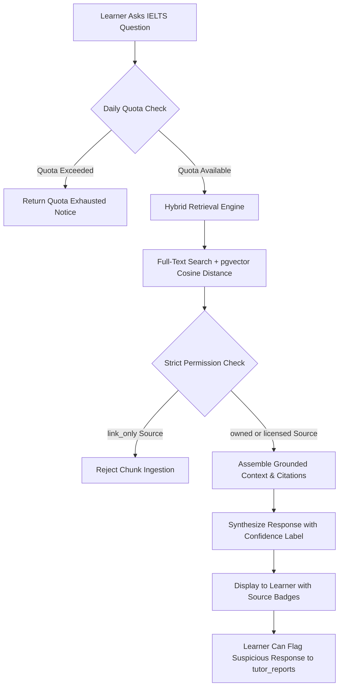

# BandBloom IELTS — Smart Computer-Delivered IELTS Preparation SaaS

> **Official Repository Documentation**  
> **Architecture Version:** 2.1 (Full-Stack Next.js 16 + PostgreSQL/pgvector Backend)  
> **Framework:** Next.js 16 (App Router, Turbopack) &bull; React 19 &bull; TypeScript 5 &bull; Tailwind CSS v4  
> **Database:** PostgreSQL 16+ with `pgvector` &bull; Redis 7 &bull; Native `pg` Connection Pooling  
> **Repository:** [https://github.com/hasinjubaier/BandBloom.git](https://github.com/hasinjubaier/BandBloom.git)

---

## Table of Contents

1. [Project Overview](#1-project-overview)
2. [Features](#2-features)
3. [Technology Stack](#3-technology-stack)
4. [Project Architecture](#4-project-architecture)
5. [Project Directory Structure](#5-project-directory-structure)
6. [Prerequisites](#6-prerequisites)
7. [Installation and Local Development](#7-installation-and-local-development)
8. [Environment Variables](#8-environment-variables)
9. [Application Routes & Backend APIs](#9-application-routes--backend-apis)
10. [Authentication and Session Architecture](#10-authentication-and-session-architecture)
11. [Database and Data Model](#11-database-and-data-model)
12. [Centralized Backend Services & Scoring Engine](#12-centralized-backend-services--scoring-engine)
13. [AI Tutor and RAG Architecture](#13-ai-tutor-and-rag-architecture)
14. [Testing and Code Quality](#14-testing-and-code-quality)
15. [Deployment](#15-deployment)
16. [Troubleshooting & Known Gotchas](#16-troubleshooting--known-gotchas)
17. [Security, Ethics & Privacy](#17-security-ethics--privacy)
18. [Contribution Guidelines](#18-contribution-guidelines)
19. [License and Legal Attribution](#19-license-and-legal-attribution)

---

## 1. Project Overview

**BandBloom IELTS** is a full-stack computer-delivered IELTS preparation platform built for candidates preparing for the **IELTS Academic** and **IELTS General Training** examinations.

### The Problem
Traditional IELTS preparation suffers from three acute pain points:
1. **Ergonomic Shock on Test Day**: The vast majority of candidates take the official computer-delivered IELTS (CD-IELTS) test, but practice using paper textbooks. On exam day, they encounter split-screen reading passages, rigid question navigation matrices, and server-authoritative countdown timers.
2. **Subjective & Slow Grading**: Writing and Speaking assessments often take days or weeks for human tutors to score, offering generic advice rather than actionable diagnostic breakdown against official band criteria.
3. **Hallucinated Guidance & Scoring Rumors**: Free online test materials frequently propagate unsupported scoring myths and hallucinated explanations without citing verified test specifications.

### The Solution
BandBloom reproduces the ergonomics of the official computer-delivered IELTS exam environment. It pairs rigorous simulation with immediate diagnostic AI evaluations grounded in official specifications, mathematical Section 5.3 band rounding rules, a personal mistake notebook, spaced repetition vocabulary, and a bilingual interface tailored for global learners.

### Current Implementation Status
- **Full-Stack Application Core**: Production-ready Next.js 16 App Router application compiled with Turbopack, supporting **46 compiled routes** (24 static pages, 2 partial prerender routes, and 20 dynamic API endpoints).
- **Backend Service Layer**: Complete server architecture in [`apps/web/src/server/`](file:///d:/Project/IELTS%20SaaS/apps/web/src/server/) comprising database pooling, session authentication, exam lifecycle management, deterministic scoring, RAG retrieval, and spaced repetition.
- **Design System**: Tailored IELTS education theme featuring pale teal canvases, rich navy typography, dark/light themes, and responsive mobile drawers.
- **State Management**: Reactive React 19 context providers for full exam sessions, bilingual translations (English & Bengali), and user preferences.
- **Database Architecture**: Comprehensive PostgreSQL 16 schema consisting of **24 normalized relational tables** across 4 migration scripts, `pgvector` HNSW semantic embeddings, and Docker Compose orchestration.
- **Security & Session Suite**: Secure SHA-256 token-based sessions, `bcryptjs` password hashing, anti-enumeration password reset tokens, and strict privacy consent gates.
- **Automated Verification**: End-to-end integration and unit test suite validating Section 5.3 scoring math, database stored function parity, authentication, one-active-attempt invariants, and RAG permission gating.

---

## 2. Features

### All Four IELTS Skill Modules
- **Reading**: Split-screen dual-pane viewer displaying academic reading passages alongside the question matrix. Supports authentic question formats:
  - True / False / Not Given & Yes / No / Not Given
  - Matching Headings & Information Location
  - Sentence Completion, Summary Completion & Diagram Labeling
- **Listening**: Audio controller with time-synchronized audio playback, official exam-paced pauses, and real-time form-filling inputs.
- **Writing**: Task 1 (academic graphs / general letters) and Task 2 (discursive essays) simulator with live word counters, distraction-free text editor, and grading breakdowns against official criteria:
  - *Task Achievement / Task Response (TA/TR)*
  - *Coherence & Cohesion (CC)*
  - *Lexical Resource (LR)*
  - *Grammatical Range & Accuracy (GRA)*
- **Speaking**: 3-part interactive interview simulation:
  - *Part 1*: Everyday familiar topics
  - *Part 2*: Long turn cue-card with an automated 1-minute preparation countdown timer and 2-minute recording window
  - *Part 3*: In-depth two-way abstract discussion
  - Built-in audio recorder with transparent microphone permissions and consent gates.

### Computer-Delivered Exam Simulation (CD-IELTS)
- **Distraction-Free Layout**: Dedicated `/mock-centre/exam` route that suppresses marketing navigation, footers, and notifications.
- **Ergonomic Question Navigation**: 40-question bottom matrix with answered, unanswered, and "Review" flags.
- **Server-Authoritative Countdown Timers**: Prevents client clock tampering; validates deadlines and auto-submits upon expiration.
- **Debounced Auto-Saves**: Real-time answer persistence to `/api/attempts/[id]/save` guaranteed by PostgreSQL unique conflict resolution.

### Official Band Rounding Engine (Section 5.3)
In strict accordance with official IELTS scoring specifications, the average of the 4 skill component scores is rounded mathematically:
- An average ending in `.25` rounds **UP** to the next half band (e.g., $6.25 \rightarrow 6.5$).
- An average ending in `.75` rounds **UP** to the next whole band (e.g., $6.75 \rightarrow 7.0$).
- Implemented symmetrically across:
  - PostgreSQL stored functions: [`ielts_round_band`](file:///d:/Project/IELTS%20SaaS/infra/migrations/001_initial_schema.sql) and [`ielts_calculate_overall_band`](file:///d:/Project/IELTS%20SaaS/infra/migrations/001_initial_schema.sql)
  - Backend scoring engine: [`roundIELTSBand`](file:///d:/Project/IELTS%20SaaS/apps/web/src/server/services/scoring.service.ts#L72-L86) and [`calculateOverallBand`](file:///d:/Project/IELTS%20SaaS/apps/web/src/server/services/scoring.service.ts#L92-L112)
  - Frontend client context: [`roundIELTSBand`](file:///d:/Project/IELTS%20SaaS/apps/web/src/context/ExamContext.tsx)

### Grounded AI Tutor & RAG Knowledge Base
- Explanations are strictly grounded in official test specifications (e.g. *IELTS Academic Reading Candidate Guide 2026*, *Official Scoring Tables*).
- Responses include source citation badges, evidence labels, and confidence classifications (`supported`, `limited`, `insufficient_evidence`).
- Daily quota tracking enforced via `audit_logs` (default: 25 requests per user/day).
- Community feedback mechanism: learners can report ambiguous or low-confidence tutor responses to the review queue (`tutor_reports`).

### Personal Mistake Notebook & Spaced Repetition Vocabulary
- **Cognitive Trap Categorization**: Identifies errors by specific tags (*paraphrase miss*, *inference trap*, *keyword trap*, *word limit breach*, *singular/plural error*).
- **Academic Word List (AWL)**: Vocabulary bank organized by CEFR/Band levels (Band 6.0 to 8.5+) with collocation patterns and Leitner spaced repetition review schedules (`user_vocabulary_progress`).

### Localization & Accessibility
- **Bilingual Interface**: Instant one-click toggle between English (`en`) and Bengali (`bn`) with zero page reloads.
- **Theme Switcher**: Smooth transitions between crisp light mode and deep teal dark mode (`#0A1C1B`).
- **WCAG 2.1 AA Compliance**: Semantic HTML, screen-reader status announcements (`aria-live`), and full keyboard navigation.

---

## 3. Technology Stack

| Layer | Technology | Version | Purpose |
| :--- | :--- | :--- | :--- |
| **Framework** | [Next.js](https://nextjs.org) | `16.4.2` | App Router, Turbopack, Partial Prerendering, API Route Handlers |
| **Frontend Library** | [React](https://react.dev) | `19.3.0` | React 19 concurrent features, transitions, actions |
| **Language** | [TypeScript](https://www.typescriptlang.org) | `^5.0.0` | Strict type safety across client and server modules |
| **Styling** | [Tailwind CSS](https://tailwindcss.com) | `^4.0.0` | Modern utility styling with `@tailwindcss/turbopack` |
| **Icons** | [Lucide React](https://lucide.dev) | `^1.60.0` | Consistent, accessible vector icon library |
| **Typography** | `next/font` | Google Geist | Optimized font delivery for Geist Sans and Geist Mono |
| **Database Pool** | [`pg`](https://node-postgres.com/) | `^8.23.1` | Native connection pooling, parameterization, and transaction management |
| **Password Hashing**| [`bcryptjs`](https://www.npmjs.com/package/bcryptjs) | `^3.0.3` | Salted bcrypt password hashing and verification |
| **Database** | [PostgreSQL](https://www.postgresql.org) | `16+` | Relational database with custom scoring triggers and stored procedures |
| **Vector Search** | [pgvector](https://github.com/pgvector/pgvector) | `0.7.0+` | HNSW cosine similarity vector indexing for RAG embeddings |
| **Caching & Queues**| [Redis](https://redis.io) | `7-alpine` | Fast session storage, background worker coordination |
| **Containerization**| [Docker Compose](https://docs.docker.com/compose/) | `3.8` | Local database, Redis, and migration orchestration |
| **Backend Testing** | Node.js Test Harness | `v20+` | 18+ automated end-to-end backend integration and unit tests |
| **Database Testing**| [Python](https://www.python.org) & `psycopg` | `3.10+` | SQL schema verification and constraint testing |

---

## 4. Project Architecture

The BandBloom codebase is organized as an enterprise monorepo managing the full-stack web client, server services, database migrations, architecture blueprints, and test suites:

```
BandBloom Monorepo Root
├── apps/
│   └── web/                   # Next.js Full-Stack App Router Application
│       ├── src/
│       │   ├── app/           # Client pages & 20+ API Route Handlers
│       │   ├── components/    # Modular UI & Layout components
│       │   ├── context/       # Client state providers (Exam, Language, Theme)
│       │   ├── data/          # Seed curriculum and translations
│       │   ├── hooks/         # Custom navigation and interaction hooks
│       │   └── server/        # Server architecture (Database, Auth, Services)
│       │       ├── auth/      # Session management & token hashing
│       │       ├── db/        # Connection pooling & transactions
│       │       └── services/  # Domain business logic & scoring
│       └── scripts/           # Maintenance and seed scripts
├── infra/
│   ├── docker/                # Docker Compose services (PostgreSQL + pgvector, Redis)
│   └── migrations/            # SQL migration scripts (001 through 004)
├── docs/
│   └── architecture/          # Engineering blueprints & entity specifications
└── tests/                     # Integration test suites (Node.js & Python)
```

### Layout Hierarchy & AppShell Architecture
[`AppShell.tsx`](file:///d:/Project/IELTS%20SaaS/apps/web/src/components/layout/AppShell.tsx) acts as the master layout router:
- **Marketing & Educational Pages**: Renders `DisclaimerBanner`, the interactive `Navbar`, child content, and `Footer`.
- **Exam Simulation (`/mock-centre/exam`)**: Suppresses all marketing elements to provide an authentic, distraction-free computer exam interface.
- **Authentication Pages (`/login`, `/signup`, `/forgot-password`)**: Renders a focused canvas without marketing headers, featuring the two-column card layout.

### Context State Management
- [`LanguageContext.tsx`](file:///d:/Project/IELTS%20SaaS/apps/web/src/context/LanguageContext.tsx): Manages active language (`en` vs `bn`), localized string mappings (`translations.ts`), and persists user preference.
- [`ThemeContext.tsx`](file:///d:/Project/IELTS%20SaaS/apps/web/src/context/ThemeContext.tsx): Detects system color schemes, toggles `dark` class on the root HTML document, and synchronizes with localStorage.
- [`ExamContext.tsx`](file:///d:/Project/IELTS%20SaaS/apps/web/src/context/ExamContext.tsx): Maintains user profile goals, active exam attempts, component band calculations, mistake notebook records, and spaced repetition vocabularies.

### Custom Navigation & Scroll Restoration Hook
[`useLandingNavigation.ts`](file:///d:/Project/IELTS%20SaaS/apps/web/src/hooks/useLandingNavigation.ts) manages landing page interactions:
- Uses the **Navigation Timing API** (`performance.getEntriesByType('navigation')[0].type === 'reload'`) to detect real browser page refreshes.
- Automatically clears stale hash fragments (such as `#ai-tutor`) via `history.replaceState` and resets scroll position cleanly to the top Hero section `(0, 0)`.
- Implements a high-precision `requestAnimationFrame`-throttled scroll spy that tracks document coordinates.

---

## 5. Project Directory Structure

```
d:\Project\IELTS SaaS
├── .env.example                               # Canonical environment variable specification
├── package.json                               # Monorepo root package.json (workspaces & test script)
├── README.md                                  # Master repository documentation (this file)
│
├── apps/
│   └── web/                                   # Next.js Full-Stack Application
│       ├── package.json                       # Dependencies & Next.js scripts
│       ├── next.config.ts                     # Turbopack & compiler configuration
│       ├── tsconfig.json                      # TypeScript strict configuration
│       ├── scripts/
│       │   └── seed-passwords.js              # Database password and demo profile seeder
│       ├── public/                            # Static assets (WebP logos, illustrations)
│       └── src/
│           ├── app/                           # App Router routes and API handlers
│           │   ├── (marketing)/               # page.tsx, test-types, test-day-guide, legal pages
│           │   ├── login/page.tsx             # Dedicated login route
│           │   ├── signup/page.tsx            # Dedicated registration route
│           │   ├── forgot-password/           # Password recovery request route
│           │   ├── onboarding/                # 4-step learner onboarding
│           │   ├── dashboard/                 # Student performance dashboard
│           │   ├── mock-centre/               # Mock test hub & /exam simulator
│           │   ├── results/[id]/              # Diagnostic score report with Section 5.3 breakdown
│           │   ├── skills/                    # Skill modules (reading, listening, writing, speaking)
│           │   ├── tutor/                     # Grounded AI tutor workspace
│           │   ├── study-plan/                # Interactive study scheduler
│           │   ├── vocabulary/                # Spaced repetition vocabulary builder
│           │   ├── notebook/                  # Personal mistake notebook
│           │   └── api/                       # 20+ Dynamic Server API Endpoints
│           │       ├── attempts/              # /save, /submit, /result
│           │       ├── auth/                  # /register, /login, /logout, /me, /forgot-password, /reset-password
│           │       ├── exams/                 # / (list), /[id], /[id]/attempt
│           │       ├── lessons/               # / (curriculum list)
│           │       ├── media/                 # /upload (audio recording authorization)
│           │       ├── notebook/              # / (list/create), /[id] (update/delete)
│           │       ├── profile/               # / (get/update profile & consents)
│           │       ├── study-plan/            # / (get tasks / toggle completion)
│           │       ├── tutor/                 # /chat, /report
│           │       └── vocabulary/            # / (list deck), /[id]/review (update SRS)
│           ├── components/                    # UI Components (auth, landing, layout, modals)
│           ├── context/                       # ExamContext, LanguageContext, ThemeContext
│           ├── data/                          # translations.ts, mockCurriculum.ts, mockQuestions.ts
│           ├── hooks/                         # useLandingNavigation.ts
│           └── server/                        # Backend Server Architecture
│               ├── auth/
│               │   └── session.ts             # Session token generation, SHA-256 hashing, auth guards
│               ├── db/
│               │   └── index.ts               # Connection pooling (pg), transactions, query logging
│               └── services/
│                   ├── exam.service.ts        # Attempt lifecycle, one-active-attempt rule, scoring
│                   ├── learning.service.ts    # Study plans, mistake notes, SRS vocabulary
│                   ├── media.service.ts       # Audio recording authorization & consent checks
│                   ├── profile.service.ts     # User profiles & GDPR/privacy consent management
│                   ├── rag.service.ts         # Hybrid knowledge retrieval, citations, daily quotas
│                   └── scoring.service.ts     # Section 5.3 rounding, raw-to-band tables, normalization
│
├── infra/                                     # Infrastructure definitions
│   ├── docker/
│   │   └── docker-compose.yml                 # PostgreSQL 16 (pgvector) & Redis 7 services
│   └── migrations/
│       ├── 001_initial_schema.sql             # 22 core tables, triggers, scoring functions
│       ├── 002_seed_data.sql                  # Academic & GT seed mock exams and questions
│       ├── 003_auth_and_profile_extensions.sql# Sessions, auth_tokens, password_hash, full_name
│       └── 004_vocabulary.sql                 # Vocabulary items, user_vocabulary_progress, seeds
│
├── docs/
│   └── architecture/
│       └── database.md                        # Entity blueprint & scoring specifications
│
└── tests/                                     # Verification test suites
    ├── run_backend_tests.js                   # Node.js backend integration & unit test suite
    ├── run_live_postgres_tests.py             # Python live PostgreSQL test runner
    └── test_database.py                       # Python unit test suite
```

---

## 6. Prerequisites

Ensure your development environment meets the following requirements:

- **Node.js**: `v20.9.0` or higher (Node 20 or Node 22 LTS recommended for Next.js 16).
- **Package Manager**: `npm` `v9.x`+ or `v10.x`+ (monorepo scripts are configured using npm workspaces).
- **Docker & Docker Compose** *(for local database)*: Docker Desktop or Docker Engine v24+.
- **Python** *(Optional for Python database tests)*: Python `3.10`+ with `psycopg` (binary) and `pytest`.

---

## 7. Installation and Local Development

### 1. Clone the Repository
```bash
git clone https://github.com/hasinjubaier/BandBloom.git
cd BandBloom
```

### 2. Install Dependencies
Install dependencies across all monorepo workspaces:
```bash
npm install
```

### 3. Configure Environment Variables
Copy the example environment configuration into the web app:
```bash
cp .env.example apps/web/.env.local
```

### 4. Start Local Database Services
Launch PostgreSQL (with `pgvector`) and Redis containers:
```bash
docker compose -f infra/docker/docker-compose.yml up -d
```

### 5. Apply Database Migrations & Seed Data
Apply all 4 database migration scripts in order:
```bash
# 1. Base schema (22 core tables, triggers, and functions)
docker exec -i bandbloom-postgres psql -U bandbloom_user -d bandbloom_db < infra/migrations/001_initial_schema.sql

# 2. Seed mock exams, sections, questions, and RAG documents
docker exec -i bandbloom-postgres psql -U bandbloom_user -d bandbloom_db < infra/migrations/002_seed_data.sql

# 3. Authentication & session management extensions
docker exec -i bandbloom-postgres psql -U bandbloom_user -d bandbloom_db < infra/migrations/003_auth_and_profile_extensions.sql

# 4. Spaced repetition vocabulary schema & seeds
docker exec -i bandbloom-postgres psql -U bandbloom_user -d bandbloom_db < infra/migrations/004_vocabulary.sql
```

### 6. Seed Demo Account Passwords
Hash and seed credentials for the built-in demo accounts:
```bash
node apps/web/scripts/seed-passwords.js
```
*(Sets password `Password123!` for `student@bandbloom.test` and `admin@bandbloom.test`)*

### 7. Run Backend Integration Tests
Validate that all backend services, database triggers, and scoring math operate correctly:
```bash
npm test
```

### 8. Start the Development Server
Launch the Next.js development server powered by Turbopack:
```bash
npm run dev
```
Open **[http://localhost:3000](http://localhost:3000)** in your browser.

### 9. Build for Production
To validate TypeScript types and build the optimized production bundle:
```bash
npm run build
```

---

## 8. Environment Variables

All variables are defined in [`.env.example`](file:///d:/Project/IELTS%20SaaS/.env.example). Never commit real secrets or production credentials to source control.

| Variable Name | Required | Context | Description & Example Value |
| :--- | :---: | :---: | :--- |
| `APP_ENV` | Optional | Server | Runtime environment (`development`, `staging`, `production`) |
| `APP_NAME` | Optional | Shared | Application display identifier (`BandBloom`) |
| `PORT` | Optional | Server | Local web server port (default: `3000` / `8000`) |
| `DEBUG` | Optional | Server | Enable verbose query duration warnings (`True` / `False`) |
| `DATABASE_URL` | Optional | Server | Async PostgreSQL connection string (`postgresql+asyncpg://...`) |
| `SYNC_DATABASE_URL` | Optional | Server | Synchronous PostgreSQL connection string (`postgresql://...`) |
| `REDIS_URL` | Optional | Server | Redis server connection string (`redis://localhost:6379/0`) |
| `OBJECT_STORAGE_ENDPOINT` | Optional | Server | S3/MinIO endpoint (`http://localhost:9000`) |
| `OBJECT_STORAGE_ACCESS_KEY` | Optional | Server | Object storage access key |
| `OBJECT_STORAGE_SECRET_KEY` | Optional | Server | Object storage secret key |
| `OBJECT_STORAGE_BUCKET` | Optional | Server | Bucket name (`bandbloom-private-media`) |
| `SIGNED_URL_TTL_SECONDS` | Optional | Server | Pre-signed URL expiration in seconds (default: `300`) |
| `LLM_API_KEY` | Optional | Server | OpenAI / Gemini API key for AI tutor grading |
| `LLM_MODEL` | Optional | Server | Language model identifier (e.g. `gpt-4o-mini`) |
| `EMBEDDING_MODEL` | Optional | Server | Embedding model identifier (`text-embedding-3-small`) |
| `EMBEDDING_DIMENSION` | Optional | Server | Vector embedding dimension size (default: `1536`) |
| `RAG_TOP_K` | Optional | Server | Number of relevant chunks retrieved per query (default: `8`) |
| `RAG_MIN_RELEVANCE` | Optional | Server | Cosine similarity cutoff threshold (default: `0.72`) |
| `MAX_TUTOR_REQUEST_CHARS` | Optional | Server | Character limit for learner prompt inputs (default: `4000`) |
| `TUTOR_PER_USER_DAILY_QUOTA`| Optional | Server | Daily AI prompt limit per learner account (default: `25`) |

---

## 9. Application Routes & Backend APIs

The application features **46 compiled routes** (26 user interface routes and 20 dynamic server API handlers):

### User Interface Routes (Pages)

| Route Path | Type | Description |
| :--- | :---: | :--- |
| `/` | `Static` | Marketing landing page: Hero, Interactive 3D Globe, Skill Labs, AI Tutor, Band Calculator |
| `/login` | `Static` | Dedicated login page with email/password form, remember me, and Google OAuth |
| `/signup` | `Static` | Dedicated registration page with password strength checks and legal consent |
| `/forgot-password` | `Static` | Secure password reset request page with anti-enumeration protection |
| `/onboarding` | `Static` | 4-step student setup: track selection, target band, exam date, daily goal, AI consent |
| `/dashboard` | `Static` | Student portal with band projection, skill readiness radar, daily study tasks |
| `/mock-centre` | `Static` | Full-length exam hub and diagnostic test selector |
| `/mock-centre/exam` | `Static` | Distraction-free full-screen CD-IELTS computer exam simulation |
| `/results/[id]` | `Partial`| Diagnostic score report with Section 5.3 rounding, criteria breakdown, and feedback |
| `/skills/reading` | `Static` | Reading practice module with split-screen passage view and 3 question formats |
| `/skills/listening` | `Static` | Listening practice module with audio controller, transcript sync, note completion |
| `/skills/writing` | `Static` | Writing Task 1 & Task 2 timed simulator with authentic live word counters |
| `/skills/speaking` | `Static` | 3-part Speaking interview simulator with microphone recorder and cue card timer |
| `/tutor` | `Static` | Grounded AI tutor workspace with source citation badges and report queue |
| `/study-plan` | `Static` | Weekly roadmap with interactive completion checkboxes |
| `/vocabulary` | `Static` | Academic Word List & Collocation bank with spaced repetition mastery tiers |
| `/notebook` | `Static` | Personal Mistake Notebook categorizing errors by cognitive trap tags |
| `/lessons` | `Static` | Curriculum lesson library sorted by skill and CEFR band level |
| `/practice` | `Static` | Quick skill drill hub |
| `/settings` | `Static` | Student settings (target band, exam date, study goal, privacy consents, language, theme)|
| `/test-types` | `Static` | Academic vs General Training track comparison guide |
| `/test-day-guide` | `Static` | Computer-delivered test room ergonomics, ID requirements, and rules |
| `/terms` | `Static` | Terms of Service governing platform usage and materials protection |
| `/privacy` | `Static` | Privacy policy and student audio recording retention guidelines |
| `/accessibility` | `Static` | Accessibility compliance statement (WCAG 2.1 AA) |
| `/ai-feedback-policy`| `Static` | AI assessment boundaries, confidence scores, and human review guidelines |
| `/disclaimer` | `Static` | Trademark notices and official non-affiliation disclaimer |
| `/how-it-works` | `Static` | Platform overview detailing diagnostic assessment and scoring methodology |

### Server API Endpoints

| Endpoint | Method | Security | Description |
| :--- | :---: | :---: | :--- |
| [`/api/auth/register`](file:///d:/Project/IELTS%20SaaS/apps/web/src/app/api/auth/register/route.ts) | `POST` | Public | Register user with bcrypt hashing, profile setup, and terms consent |
| [`/api/auth/login`](file:///d:/Project/IELTS%20SaaS/apps/web/src/app/api/auth/login/route.ts) | `POST` | Public | Authenticate user, issue SHA-256 hashed session token in HttpOnly cookie |
| [`/api/auth/logout`](file:///d:/Project/IELTS%20SaaS/apps/web/src/app/api/auth/logout/route.ts) | `POST` | Public | Invalidate active session in database and delete session cookie |
| [`/api/auth/me`](file:///d:/Project/IELTS%20SaaS/apps/web/src/app/api/auth/me/route.ts) | `GET` | Optional | Return authenticated user session, profile, and role |
| [`/api/auth/forgot-password`](file:///d:/Project/IELTS%20SaaS/apps/web/src/app/api/auth/forgot-password/route.ts) | `POST` | Public | Generate password reset token with anti-enumeration protection |
| [`/api/auth/reset-password`](file:///d:/Project/IELTS%20SaaS/apps/web/src/app/api/auth/reset-password/route.ts) | `POST` | Public | Verify reset token and update user password hash |
| [`/api/exams`](file:///d:/Project/IELTS%20SaaS/apps/web/src/app/api/exams/route.ts) | `GET` | Public | List published mock exams with section counts and total durations |
| [`/api/exams/[id]`](file:///d:/Project/IELTS%20SaaS/apps/web/src/app/api/exams/[id]/route.ts) | `GET` | Public | Fetch exam details and ordered section breakdown |
| [`/api/exams/[id]/attempt`](file:///d:/Project/IELTS%20SaaS/apps/web/src/app/api/exams/[id]/attempt/route.ts) | `POST` | Authenticated | Start or resume active attempt (enforces one-active-attempt rule) |
| [`/api/attempts/[id]/save`](file:///d:/Project/IELTS%20SaaS/apps/web/src/app/api/attempts/[id]/save/route.ts) | `POST` | Authenticated | Idempotent debounced autosave of student answers and review flags |
| [`/api/attempts/[id]/submit`](file:///d:/Project/IELTS%20SaaS/apps/web/src/app/api/attempts/[id]/submit/route.ts) | `POST` | Authenticated | Finalize attempt, grade objective sections, and persist Section 5.3 bands |
| [`/api/attempts/[id]/result`](file:///d:/Project/IELTS%20SaaS/apps/web/src/app/api/attempts/[id]/result/route.ts) | `GET` | Authenticated | Fetch complete diagnostic score report, skill breakdown, and rounding math |
| [`/api/tutor/chat`](file:///d:/Project/IELTS%20SaaS/apps/web/src/app/api/tutor/chat/route.ts) | `POST` | Authenticated | Query grounded RAG tutor with hybrid retrieval, quota checks, and citations |
| [`/api/tutor/report`](file:///d:/Project/IELTS%20SaaS/apps/web/src/app/api/tutor/report/route.ts) | `POST` | Authenticated | Submit learner hallucination/inaccuracy report to review queue |
| [`/api/profile`](file:///d:/Project/IELTS%20SaaS/apps/web/src/app/api/profile/route.ts) | `GET`, `PUT` | Authenticated | Retrieve or update user profile, target band, exam date, and consents |
| [`/api/study-plan`](file:///d:/Project/IELTS%20SaaS/apps/web/src/app/api/study-plan/route.ts) | `GET`, `POST` | Authenticated | Fetch active weekly tasks or toggle task completion status |
| [`/api/notebook`](file:///d:/Project/IELTS%20SaaS/apps/web/src/app/api/notebook/route.ts) | `GET`, `POST` | Authenticated | List mistake notes with skill/tag filtering or create a new mistake note |
| [`/api/notebook/[id]`](file:///d:/Project/IELTS%20SaaS/apps/web/src/app/api/notebook/[id]/route.ts) | `PATCH`, `DELETE` | Authenticated | Update mistake retry status (`pending`, `mastered`) or remove note |
| [`/api/vocabulary`](file:///d:/Project/IELTS%20SaaS/apps/web/src/app/api/vocabulary/route.ts) | `GET` | Authenticated | Fetch academic vocabulary deck with spaced repetition review statuses |
| [`/api/vocabulary/[id]/review`](file:///d:/Project/IELTS%20SaaS/apps/web/src/app/api/vocabulary/[id]/review/route.ts) | `POST` | Authenticated | Record review outcome and advance Leitner spaced repetition interval |
| [`/api/media/upload`](file:///d:/Project/IELTS%20SaaS/apps/web/src/app/api/media/upload/route.ts) | `POST` | Authenticated | Authorize audio recording upload after verifying user recording consent |
| [`/api/lessons`](file:///d:/Project/IELTS%20SaaS/apps/web/src/app/api/lessons/route.ts) | `GET` | Public | List curriculum lessons filtered by skill and CEFR band level |

---

## 10. Authentication and Session Architecture

BandBloom implements an enterprise token-based session management system governed by [`session.ts`](file:///d:/Project/IELTS%20SaaS/apps/web/src/server/auth/session.ts):

```mermaid
sequenceDiagram
    autonumber
    actor Learner as Learner Browser
    participant API as /api/auth/login
    participant Service as session.ts
    participant DB as PostgreSQL (sessions table)

    Learner->>API: POST { email, password }
    API->>DB: Query user by email
    DB-->>API: User record (password_hash)
    API->>Service: verifyPassword(password, hash)
    Service-->>API: true (bcrypt match)
    API->>Service: createSession(userId, req)
    Note over Service: Generates 32-byte crypto token<br/>Computes SHA-256 hash<br/>Captures IP & User-Agent
    Service->>DB: INSERT INTO sessions (token_hash, expires_at, ip_address, ...)
    DB-->>Service: OK
    Service-->>API: { token, expiresAt }
    API-->>Learner: 200 OK + Set-Cookie: bandbloom_session=<token>; HttpOnly; SameSite=Lax
```

### Key Security Invariants
- **Cryptographic Hashing**: Raw session tokens are never stored in the database. Only the SHA-256 hash of the 32-byte token (`token_hash`) is persisted.
- **Bcrypt Password Storage**: Passwords are encrypted with 10 salt rounds via [`hashPassword`](file:///d:/Project/IELTS%20SaaS/apps/web/src/server/auth/session.ts#L18-L21).
- **Session Expiration**: Sessions expire after 7 days by default (`SESSION_EXPIRY_DAYS = 7`).
- **Flexible Token Extraction**: [`extractSessionToken`](file:///d:/Project/IELTS%20SaaS/apps/web/src/server/auth/session.ts#L73-L91) extracts credentials transparently from either the `bandbloom_session` HttpOnly cookie or the `Authorization: Bearer <token>` header.
- **Session Invalidation**: Calling [`invalidateSession`](file:///d:/Project/IELTS%20SaaS/apps/web/src/server/auth/session.ts#L64-L67) immediately removes the token hash from the database.
- **Anti-Enumeration Protection**: Password reset and recovery flows return identical success acknowledgments regardless of whether the submitted email address exists.

---

## 11. Database and Data Model

The schema consists of **24 normalized relational tables** defined across 4 sequential migration files in [`infra/migrations/`](file:///d:/Project/IELTS%20SaaS/infra/migrations/):

### Table Breakdown by Domain

1. **Identity & Authentication**:
   - `users`: Core identity, roles (`student`, `tutor`, `admin`), active status, `password_hash`.
   - `profiles`: Student details, `full_name`, test type (`academic` / `general_training`), target band, target date.
   - `sessions`: Active login sessions, `token_hash`, expiration timestamp, client IP, user agent.
   - `auth_tokens`: Password reset and email verification tokens with expiration and single-use consumption tracking.
   - `consents`: GDPR/privacy consents (`terms_and_privacy`, `recording`, `ai_training`) with versioning and revocation timestamps.
2. **Mock Exam Engine**:
   - `exams`: Mock exams with title, test type, versioning, and publishing status.
   - `exam_sections`: Ordered skill sections (Reading, Listening, Writing, Speaking) with duration and instructions.
   - `exam_section_questions`: Join table mapping questions to specific exam sections with sequence ordering.
   - `attempts`: Candidate test sessions with status (`in_progress`, `submitted`, `evaluated`), server deadlines, and config snapshots.
   - `responses`: Candidate answers stored as JSONB with unique constraint `(attempt_id, question_id)`.
   - `scores`: Component and overall scores with raw marks and Section 5.3 estimated bands.
   - `feedback`: Detailed diagnostic feedback per skill component with criteria breakdown.
3. **Content Bank**:
   - `lessons`: Curated video and article lessons by skill and target band.
   - `questions`: Reusable question bank items with prompts, types, and context passages.
   - `question_options`: Structured answer choices and official keys for objective items.
4. **Learning & Spaced Repetition**:
   - `study_plans`: Personalized weekly schedules with task lists and completion flags.
   - `mistake_notes`: Error notebook categorized by cognitive trap tags and mastery statuses (`pending`, `mastered`).
   - `vocabulary_items`: Academic Word List entries with definitions, collocations, and example sentences.
   - `user_vocabulary_progress`: Spaced repetition state, Leitner interval days, and next review timestamps.
5. **Media & Student Audio**:
   - `media_assets`: System audio and image assets.
   - `recordings`: Candidate speaking audio recording references with consent foreign keys and retention policies.
6. **RAG Knowledge Base & Operations**:
   - `content_sources`: Official documentation sources with strict `permission_status` (`owned`, `licensed`, `link_only`).
   - `content_chunks`: 1536-dimensional semantic vector embeddings (`pgvector`) and full-text search tokens (`fts`).
   - `tutor_reports`: Learner hallucination reports for human audit.
   - `ai_jobs`: Background asynchronous job tracking.
   - `audit_logs`: Audit trail for security actions and daily AI tutor query quota tracking.

### Core Architectural Invariants
- **One-Active-Attempt Rule**: A partial unique index on `attempts(user_id, exam_id) WHERE status = 'in_progress'` prevents concurrent duplicate exam sessions.
- **Idempotent Auto-Saves**: `responses` enforces `UNIQUE (attempt_id, question_id)`, ensuring debounced auto-saves never duplicate database rows.
- **RAG Permission Guard Trigger**: `trg_prevent_chunking_link_only_source` strictly prohibits inserting chunks for `link_only` sources at the database level.
- **Content Immutability**: Active attempts store a `config_snapshot` JSONB to preserve grading integrity even if question bank items are edited in the future.

---

## 12. Centralized Backend Services & Scoring Engine

All server-side business logic resides in dedicated services in [`apps/web/src/server/services/`](file:///d:/Project/IELTS%20SaaS/apps/web/src/server/services/):

### 1. Scoring Engine ([`scoring.service.ts`](file:///d:/Project/IELTS%20SaaS/apps/web/src/server/services/scoring.service.ts))
- **Official Raw-to-Band Tables**:
  - `ACADEMIC_READING_TABLE`: 40-mark scale mapping raw marks (0–40) to bands (2.0–9.0).
  - `GENERAL_READING_TABLE`: General Training raw-to-band conversion.
  - `LISTENING_TABLE`: 40-mark scale for listening sections.
- **Section 5.3 Mathematical Rounding**:
  [`roundIELTSBand`](file:///d:/Project/IELTS%20SaaS/apps/web/src/server/services/scoring.service.ts#L72-L86) implements the official rounding algorithm:
  $$\text{Fraction} < 0.25 \rightarrow \lfloor \text{band} \rfloor$$
  $$0.25 \le \text{Fraction} < 0.75 \rightarrow \lfloor \text{band} \rfloor + 0.5$$
  $$\text{Fraction} \ge 0.75 \rightarrow \lfloor \text{band} \rfloor + 1.0$$
- **Answer Normalization & Objective Evaluation**:
  [`evaluateObjectiveAnswer`](file:///d:/Project/IELTS%20SaaS/apps/web/src/server/services/scoring.service.ts#L149-L208) handles case insensitivity, punctuation stripping, and canonical synonyms for True/False/Not Given (`T` $\rightarrow$ `True`, `NG` $\rightarrow$ `Not Given`).

### 2. Exam Service ([`exam.service.ts`](file:///d:/Project/IELTS%20SaaS/apps/web/src/server/services/exam.service.ts))
- Coordinates full exam lifecycles: listing active tests, retrieving ordered sections and questions, starting attempts, debouncing answers, enforcing deadlines, and computing final diagnostic scores.

### 3. Learning Service ([`learning.service.ts`](file:///d:/Project/IELTS%20SaaS/apps/web/src/server/services/learning.service.ts))
- Manages student weekly study plans, mistake notebook entries with error tags, and Leitner spaced repetition interval progression for academic vocabulary.

### 4. Profile & Consent Service ([`profile.service.ts`](file:///d:/Project/IELTS%20SaaS/apps/web/src/server/services/profile.service.ts))
- Provides profile updates and transactional consent updates, tracking versioned policy agreements.

### 5. Media Service ([`media.service.ts`](file:///d:/Project/IELTS%20SaaS/apps/web/src/server/services/media.service.ts))
- Enforces explicit `recording` consent before issuing signed upload URLs, validating audio formats and enforcing a 25MB file size limit.

---

## 13. AI Tutor and RAG Architecture

BandBloom employs a grounded Retrieval-Augmented Generation (RAG) system in [`rag.service.ts`](file:///d:/Project/IELTS%20SaaS/apps/web/src/server/services/rag.service.ts) to prevent AI hallucination:



### Knowledge Pipeline Highlights
1. **Source Gating**: Content items are registered in `content_sources`. A database check constraint enforces that only sources with `permission_status IN ('owned', 'licensed', 'link_only')` can enter a `published` state.
2. **Strict Ingestion Trigger**: `trg_prevent_chunking_link_only_source` automatically blocks any attempt to insert chunks referencing `link_only` sources.
3. **Hybrid Search**: Combines semantic similarity (`pgvector` cosine distance index) with lexical search (`GIN` full-text index on `fts`).
4. **Daily Quota Protection**: [`checkUserDailyQuota`](file:///d:/Project/IELTS%20SaaS/apps/web/src/server/services/rag.service.ts#L33-L53) ensures users do not exceed the daily query limit (default: 25 queries).
5. **Community Audit**: Responses include a report button that submits suspect answers to the `tutor_reports` table for human review.

---

## 14. Testing and Code Quality

### 1. Automated Backend Verification Suite
Execute the comprehensive Node.js integration and unit test suite:
```bash
npm test
```
This runs [`tests/run_backend_tests.js`](file:///d:/Project/IELTS%20SaaS/tests/run_backend_tests.js) which validates:
- **Group 1**: Official IELTS Section 5.3 rounding rules, boundary conditions (`.24`, `.25`, `.74`, `.75`), and 4-skill component averaging.
- **Group 2**: PostgreSQL stored function parity ([`ielts_round_band`](file:///d:/Project/IELTS%20SaaS/infra/migrations/001_initial_schema.sql) vs JS).
- **Group 3**: Bcrypt password hashing, verification, user creation, duplicate email rejection, and SHA-256 session tokens.
- **Group 4**: Exam attempt lifecycle, one-active-attempt invariant, idempotent autosaving (`ON CONFLICT`), and score persistence.
- **Group 5**: RAG knowledge base permission gating (verifying trigger rejection of `link_only` source chunking).
- **Group 6**: Personal mistake notebook creation, user scoping, and retry resolution.

### 2. Next.js Production Build Validation
Verify that all 46 UI and API routes compile and prerender cleanly:
```bash
npm run build
```

### 3. Python Database Test Suites
To run the live PostgreSQL Python integration suite:
```bash
python tests/run_live_postgres_tests.py
```
To run the schema model unit test suite:
```bash
python -m unittest tests/test_database.py
```

---

## 15. Deployment

### Frontend (Vercel, AWS Amplify, or Next.js Node Host)
The Next.js application in `apps/web` is optimized for modern edge and serverless platforms:
- **Root Directory**: `apps/web` (or monorepo root with `apps/web` build prefix)
- **Build Command**: `npm run build`
- **Output Directory**: `.next`
- **Install Command**: `npm install`
- **Environment Variables**: Configure the variables documented in [Section 8](#8-environment-variables).

### Database Infrastructure
Deploy PostgreSQL 16 with the `vector` extension enabled, then apply the migrations in order:
```bash
psql -h <host> -U <user> -d <dbname> -f infra/migrations/001_initial_schema.sql
psql -h <host> -U <user> -d <dbname> -f infra/migrations/002_seed_data.sql
psql -h <host> -U <user> -d <dbname> -f infra/migrations/003_auth_and_profile_extensions.sql
psql -h <host> -U <user> -d <dbname> -f infra/migrations/004_vocabulary.sql
```

---

## 16. Troubleshooting & Known Gotchas

| Symptom / Error | Root Cause | Verified Resolution |
| :--- | :--- | :--- |
| `npm run dev` fails with `ENOENT: package.json` | Running command from subfolder or root without workspace configuration | Use root `npm run dev` (delegates via `--prefix apps/web`) |
| Page refresh lands at `#ai-tutor` instead of Home | Browser URL fragment & `scrollRestoration` restoring last scroll | Resolved in [`useLandingNavigation.ts`](file:///d:/Project/IELTS%20SaaS/apps/web/src/hooks/useLandingNavigation.ts) using Navigation Timing reload detection and `history.replaceState` |
| `usePathname() outside of <Suspense>` error during build | Next.js dynamic hook accessed during prerender without boundary | Resolved in [`AppShell.tsx`](file:///d:/Project/IELTS%20SaaS/apps/web/src/components/layout/AppShell.tsx) with a `<Suspense>` wrapper around `AppShellInner` |
| Turbopack ICO decoding error: `PNG not in RGBA format` | `favicon.ico` contains RGB metadata instead of 32-bit RGBA | Converted `favicon.ico` explicitly to 32x32 RGBA using Pillow |
| `ECONNREFUSED 127.0.0.1:5432` during tests or API queries | Local PostgreSQL Docker container is not running | Start the database services using `docker compose -f infra/docker/docker-compose.yml up -d` |
| Route `/api/lessons` or `/api/vocabulary` bail out of prerender | Dynamic request headers/URL accessed during static generation | Expected behavior in Next.js 16; route correctly switches to dynamic execution (`ƒ`) |

---

## 17. Security, Ethics & Privacy

- **Audio Consent & Retention (Section 2.3)**: Audio recorded during Speaking simulations is flagged with explicit learner authorization. Audio records support soft deletion (`deleted_at`) and automated expiration.
- **Model Training Opt-In**: Learners must explicitly opt in before anonymized writing or speaking samples can be used for evaluation model fine-tuning.
- **Age Declaration**: Learners declare they are 16+ or possess parental authorization during onboarding.
- **Rate Limiting & Quotas**: AI prompts are subject to per-user daily quotas (`TUTOR_PER_USER_DAILY_QUOTA = 25`) and character caps (`MAX_TUTOR_REQUEST_CHARS = 4000`) to prevent abuse.
- **Cryptographic Credential Storage**: Raw passwords and sensitive session tokens are never stored in plain text or transmitted insecurely.

---

## 18. Contribution Guidelines

1. **Branching**: Create feature branches from `main` (`feature/your-feature-name` or `fix/issue-description`).
2. **Commit Conventions**: Use [Conventional Commits](https://www.conventionalcommits.org/):
   - `feat(scope): ...` for new capabilities
   - `fix(scope): ...` for bug fixes
   - `docs(scope): ...` for documentation updates
   - `refactor(scope): ...` for architectural improvements
3. **Verification**: Always run `npm test` and `npm run build` prior to opening a pull request.
4. **Code Quality**: Preserve existing comments, avoid redundant abstractions, and adhere to established design tokens.

---

## 19. License and Legal Attribution

### Trademark & Disclaimer
**IELTS&reg;** is a registered trademark of the **University of Cambridge ESOL Examinations**, the **British Council**, and **IDP Education Australia**. 

BandBloom IELTS is an independent study preparation platform developed by BandBloom. BandBloom is not endorsed by, affiliated with, authorized, or sponsored by the official IELTS test owners. Practice tests, AI evaluations, and diagnostic band scores provided on this platform are unofficial estimates designed exclusively for academic preparation.

### Source Code License
The source code, user interface designs, and curriculum configurations within this repository are proprietary. For licensing, institutional use, or contribution inquiries, contact the repository maintainers.
