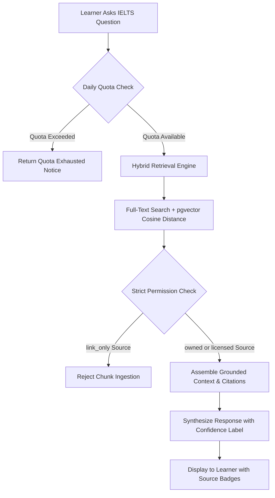

# BandBloom IELTS — Smart Computer-Delivered IELTS Preparation SaaS

> **Official Repository Documentation**  
> **Architecture Version:** 2026.1 (Full-Stack Next.js 16 + PostgreSQL/pgvector Backend + Student Portal)  
> **Framework:** Next.js 16.4.2 (App Router, Turbopack, Partial Prerendering) &bull; React 19.3 &bull; TypeScript 5.9 &bull; Tailwind CSS v4  
> **Database:** PostgreSQL 16+ with `pgvector` &bull; Redis 7 &bull; Native `pg` Connection Pooling (8 SQL Migrations)  
> **Python Service Layer:** Python 3.10+ &bull; SQLAlchemy 2.0 &bull; Alembic  
> **Repository:** [https://github.com/hasinjubaier/BandBloom.git](https://github.com/hasinjubaier/BandBloom.git)

---

## Table of Contents

1. [Project Overview](#1-project-overview)
2. [Features](#2-features)
3. [Technology Stack](#3-technology-stack)
4. [Project Architecture](#4-project-architecture)
5. [Project Directory Structure](#5-project-directory-structure)
6. [Prerequisites](#6-prerequisites)
7. [Installation and Local Development](#7-installation-and-local-development)
8. [Environment Variables](#8-environment-variables)
9. [Application Routes & Backend APIs](#9-application-routes--backend-apis)
10. [Authentication, Middleware & Session Architecture](#10-authentication-middleware--session-architecture)
11. [Database and Data Model](#11-database-and-data-model)
12. [Centralized Backend Services & Scoring Engine](#12-centralized-backend-services--scoring-engine)
13. [AI Tutor and Grounding Architecture](#13-ai-tutor-and-grounding-architecture)
14. [Testing and Code Quality](#14-testing-and-code-quality)
15. [Deployment](#15-deployment)
16. [Troubleshooting & Known Gotchas](#16-troubleshooting--known-gotchas)
17. [Security, Ethics & Privacy](#17-security-ethics--privacy)
18. [Contribution Guidelines](#18-contribution-guidelines)
19. [License and Legal Attribution](#19-license-and-legal-attribution)

---

## 1. Project Overview

**BandBloom IELTS** is an enterprise-grade computer-delivered IELTS preparation platform built for candidates preparing for the **IELTS Academic** and **IELTS General Training** examinations.

### The Problem
Traditional IELTS preparation suffers from three acute pain points:
1. **Ergonomic Shock on Test Day**: The vast majority of candidates take the official computer-delivered IELTS (CD-IELTS) test, but practice using paper textbooks. On exam day, they encounter split-screen reading passages, rigid question navigation matrices, and server-authoritative countdown timers.
2. **Subjective & Slow Grading**: Writing and Speaking assessments often take days or weeks for human tutors to score, offering generic advice rather than actionable diagnostic breakdown against official band criteria.
3. **Hallucinated Guidance & Fabricated Scores**: Free online test materials frequently propagate unsupported scoring myths, hallucinated explanations, and inaccurate band score conversions based on tiny 3-to-4 question drills without citing verified test specifications.

### The Solution
BandBloom reproduces the ergonomics of the official computer-delivered IELTS exam environment. It pairs rigorous simulation with immediate diagnostic AI evaluations grounded in official specifications, mathematical Section 5.3 band rounding rules, a personal mistake notebook, spaced repetition vocabulary, an adaptive study plan, and a bilingual interface tailored for global learners.

### Current Implementation Status
- **Full-Stack Application Core**: Production-ready Next.js 16 App Router application compiled with Turbopack, supporting **49 compiled routes** (26 static pages, 2 partial prerender dynamic routes, and 21 dynamic server API endpoints) guarded by edge middleware.
- **Dedicated Student Portal**: [`PortalShell.tsx`](file:///d:/Project/IELTS%20SaaS/apps/web/src/components/portal/PortalShell.tsx) providing a unified 14-item navigation suite across Overview, Core IELTS Skills, AI & Learning Tools, and Account management, complete with fixed desktop sidebar, mobile drawer, band goal tracking, and safe logout flow.
- **Reading Module Architecture**: Dedicated test-type aware learning and evaluation hub [`ReadingModuleView.tsx`](file:///d:/Project/IELTS%20SaaS/apps/web/src/components/portal/ReadingModuleView.tsx) and [`reading-module-data.ts`](file:///d:/Project/IELTS%20SaaS/apps/web/src/lib/reading-module-data.ts) featuring all 14 official IELTS question formats, TFNG vs YNNG distinction, strict word limit rules, matching option reuse controls, and server-side content gating.
- **Practice Hub**: Fully integrated 4-skill practice suite [`apps/web/src/app/practice/page.tsx`](file:///d:/Project/IELTS%20SaaS/apps/web/src/app/practice/page.tsx) with paragraph-level evidence mapping for Reading, listening audio drills with browser synthesis fallback, 2:1 Task 2:1 writing band weighting, and audio-disclosed Speaking Part 2 evaluation.
- **Mock Test Centre**: Refactored exam centre [`apps/web/src/app/mock-centre/page.tsx`](file:///d:/Project/IELTS%20SaaS/apps/web/src/app/mock-centre/page.tsx) and simulator [`/mock-centre/exam`](file:///d:/Project/IELTS%20SaaS/apps/web/src/app/mock-centre/exam/page.tsx) with strict Full Mock vs Sectional separation, server-authoritative countdown timers, and pre-submission answer-key security.
- **Adaptive Study Plan**: Personalized weekly study planner [`study-plan.service.ts`](file:///d:/Project/IELTS%20SaaS/apps/web/src/server/services/study-plan.service.ts) enforcing aggregate daily study-time limits, task rescheduling with day capacity checks, mistake notebook error tag prioritization, and reflection history persistence.
- **Results & Progress**: Dual-mode score reporting [`apps/web/src/app/results/page.tsx`](file:///d:/Project/IELTS%20SaaS/apps/web/src/app/results/page.tsx) and [`[id]/page.tsx`](file:///d:/Project/IELTS%20SaaS/apps/web/src/app/results/[id]/page.tsx) separating raw accuracy diagnostic drills from calibrated official band mock reports.
- **Edge Middleware & Security**: [`middleware.ts`](file:///d:/Project/IELTS%20SaaS/apps/web/src/middleware.ts) protecting all student portal routes and APIs, preventing unauthenticated access, sanitizing open redirects with [`redirect.ts`](file:///d:/Project/IELTS%20SaaS/apps/web/src/lib/redirect.ts), and enforcing cross-student tenant isolation.
- **Backend Service Layer**: Modular server architecture in [`apps/web/src/server/services/`](file:///d:/Project/IELTS%20SaaS/apps/web/src/server/services/) comprising 9 dedicated domain services: `mock.service.ts`, `practice.service.ts`, `dashboard.service.ts`, `notebook.service.ts`, `study-plan.service.ts`, `vocabulary.service.ts`, `tutor.service.ts`, `profile.service.ts`, and `session.service.ts`.
- **Database Architecture**: Comprehensive PostgreSQL 16 schema consisting of **24 normalized relational tables** across **8 migration scripts**, `pgvector` semantic vector indexing, connection pooling with slow-query profiling, and Docker Compose orchestration.
- **Python SQLAlchemy Model Suite**: Parallel declarative models in [`apps/api/src/db/models/`](file:///d:/Project/IELTS%20SaaS/apps/api/src/db/models/) with Alembic migration scaffolding and unit tests (`tests/test_database.py`).
- **Automated Verification**: Comprehensive test harness featuring **64 automated tests** across 7 test suites, validating assessment type gating, pre-submission answer-key sanitization, 14 question formats, 2:1 writing band weights, and study plan scheduling constraints.

---

## 2. Features

### Reading Module & Learning Hub ([`ReadingModuleView.tsx`](file:///d:/Project/IELTS%20SaaS/apps/web/src/components/portal/ReadingModuleView.tsx))
- **Authoritative Stream Separation**:
  - **Academic Reading**: 3 long academic texts (2,150–2,750 words total) sourced from books, journals, magazines, and newspapers.
  - **General Training Reading**: 3 sections (Section 1: 2–3 short factual survival texts; Section 2: 2 workplace texts; Section 3: 1 longer general-interest text).
- **Indicative Raw Score Guides**:
  - Separate raw-to-band conversion tables reflecting official test difficulty variations:
    - *Academic*: Band 7.0 requires **30–32 correct / 40**.
    - *General Training*: Band 7.0 requires **34–35 correct / 40**.
  - Honest disclosure notice explaining test version variability and objective clerical marking.
- **Complete 14 IELTS Question Types Library**:
  Every question format is supported with authoritative strategies, common traps, and status tiers:
  1. *True / False / Not Given (TFNG)*: Fact-based verification against text.
  2. *Yes / No / Not Given (YNNG)*: Writer's claims/opinions (strictly distinguished from TFNG).
  3. *Matching Headings*: Identifying central paragraph concepts with `allowReuse: false` controls.
  4. *Matching Information*: Locating specific details, reasons, or examples across paragraphs.
  5. *Matching Features*: Linking statements to people, theories, or historical periods.
  6. *Matching Sentence Endings*: Synthesizing grammatical and logical conclusions.
  7. *Multiple Choice (Single Answer)*: 4-option questions targeting main ideas and details.
  8. *Multiple Choice (Multiple Answers)*: Pick-two or pick-three items with proportional credit.
  9. *Sentence Completion*: Exact word extracts from passage.
  10. *Summary Completion (from text)*: Filling blanks directly from passage wording.
  11. *Summary Completion (with wordlist)*: Matching synonyms or paraphrases from an option box.
  12. *Note / Table / Flow-chart Completion*: Sequential data extraction.
  13. *Diagram Label Completion*: Technical or biological illustration labeling.
  14. *Short-Answer Questions*: Factual extraction adhering to restrictive constraints.
- **Advanced Validation Engine ([`reading-module-data.ts`](file:///d:/Project/IELTS%20SaaS/apps/web/src/lib/reading-module-data.ts))**:
  - Case-insensitive, whitespace-trimmed, and quotation/punctuation-stripped comparisons.
  - Hyphenated word counting rules (`state-of-the-art` counts strictly as 1 word).
  - Strict word limit enforcement (`NO MORE THAN THREE WORDS`, `ONE NUMBER ONLY`).
  - Authorized variant acceptance (e.g. `15` vs `fifteen`) without accepting arbitrary unlisted synonyms.
- **Three Structured Practice Modes**:
  - *Mode 1: Untimed Learning Mode* (Instant strategy review and hint prompts).
  - *Mode 2: Timed Practice Mode* (20-minute calibrated sectional drill).
  - *Mode 3: Full Reading Simulation* (**Content Gated** · 40 Questions Required across 3 passages).
- **Server-Side Content Gating**:
  - Full reading simulations require strictly 40 distinct valid questions across 3 passages/sections.
  - Partial diagnostic sets (< 40 questions) are honestly labeled and blocked from generating calibrated official band scores.

### Practice Hub ([`/practice`](file:///d:/Project/IELTS%20SaaS/apps/web/src/app/practice/page.tsx))
- **Reading Lab**: Delivers Academic and General Training practice passages with instant paragraph-level evidence mapping, explanation notes, and mistake notebook integration.
- **Listening Lab**: Section 1 campus dialogue drill with synchronized audio controls and local browser speech synthesis fallback.
- **Writing Evaluator**: Dual Task 1 and Task 2 input panels with live word count tracking, minimum word requirement warnings (150 words Task 1, 250 words Task 2), and **strict 2:1 official examiner weighting**:
  $$\text{Writing Band} = \text{round}\left(\frac{\text{Task 1} \times 1 + \text{Task 2} \times 2}{3}\right)$$
- **Speaking Recorder**: Part 2 candidate task card with automated 1-minute notes prep countdown, 2-minute recording turn, recognized transcript editing, and educational diagnostic breakdown across Fluency, Lexical Resource, and Grammar (with audio-based pronunciation disclaimer).

### Computer-Delivered Exam Simulation (CD-IELTS)
- **Authentic Test Environment**: Dedicated `/mock-centre/exam` route delivering section-based CD-IELTS tests.
- **Ergonomic Question Navigation**: Question matrix with answered, unanswered, and review flags.
- **Server-Authoritative Countdown Timers**: Prevents client clock tampering; validates deadlines with a 60-second network grace period and auto-submits upon expiration.
- **Debounced Auto-Saves**: Real-time answer persistence to `/api/attempts/[id]` (PATCH) guaranteed by PostgreSQL unique conflict resolution.
- **Pre-Submission Answer-Key Security**: `GET /api/exams/[id]` and `GET /api/attempts/[id]` strip all correct answers, explanations, and variants prior to submission.

### Official Band Rounding Engine (Section 5.3)
In strict accordance with official IELTS scoring specifications, component scores are averaged and rounded:
- An average ending in `.25` rounds **UP** to the next half band (e.g., $6.25 \rightarrow 6.5$).
- An average ending in `.75` rounds **UP** to the next whole band (e.g., $6.75 \rightarrow 7.0$).
- Symmetrically implemented across PostgreSQL stored functions, backend TypeScript services, and client React contexts.

### Adaptive Study Plan ([`/study-plan`](file:///d:/Project/IELTS%20SaaS/apps/web/src/app/study-plan/page.tsx))
- **Daily Time Constraint**: Tasks strictly scale and fit within the student's `daily_minutes` preference (e.g. 30m vs 120m).
- **Task Rescheduling Engine**: Drag/move tasks to other weekdays while strictly enforcing aggregate daily study limits.
- **Notebook Weakness Prioritization**: Automatically prioritizes tasks addressing open error tags from the Mistake Notebook.
- **Reflection History**: Weekly self-reflection forms preserved across plan iterations.
- **Diagnostic Protection**: Diagnostic attempts are excluded from full mock baselines, preventing uncalibrated plan generation.

### Grounded AI Tutor ([`/tutor`](file:///d:/Project/IELTS%20SaaS/apps/web/src/app/tutor/page.tsx))
- Explanations are strictly grounded in official test specifications (e.g. *IELTS Academic Reading Candidate Guide 2026*, *Official Scoring Tables*).
- Responses include source citation badges, evidence labels, and confidence classifications (`supported`, `limited`, `insufficient_evidence`).
- Daily quota tracking enforced via `audit_logs` (default: 25 requests per user/day).

### Personal Mistake Notebook & Spaced Repetition Vocabulary
- **Cognitive Trap Categorization**: Identifies errors by specific tags (*keyword trap*, *paraphrase miss*, *inference trap*, *word limit breach*, *antonym trap*).
- **Academic Word List (AWL)**: Vocabulary bank organized by CEFR/Band levels (Band 6.0 to 8.5+) with collocation patterns, examples, and Leitner spaced repetition mastery toggles.

### Localization & Accessibility
- **Bilingual Interface**: Instant toggle between English (`en`) and Bengali (`bn`) with zero page reloads via [`LanguageContext.tsx`](file:///d:/Project/IELTS%20SaaS/apps/web/src/context/LanguageContext.tsx).
- **Theme Switcher**: Smooth transitions between crisp light mode and deep teal dark mode (`#0A1C1B`) via [`ThemeContext.tsx`](file:///d:/Project/IELTS%20SaaS/apps/web/src/context/ThemeContext.tsx).
- **WCAG 2.1 AA Compliance**: Semantic HTML, screen-reader status announcements (`aria-live`), and full keyboard navigation.

---

## 3. Technology Stack

| Layer | Technology | Version | Purpose |
| :--- | :--- | :--- | :--- |
| **Framework** | [Next.js](https://nextjs.org) | `16.4.2` | App Router, Turbopack, Partial Prerendering, Edge Middleware |
| **Frontend Library** | [React](https://react.dev) | `19.3.0` | React 19 concurrent features, transitions, actions |
| **Language** | [TypeScript](https://www.typescriptlang.org) | `^5.9.0` | Strict type safety across client and server modules |
| **Styling** | [Tailwind CSS](https://tailwindcss.com) | `^4.0.0` | Modern utility styling with `@tailwindcss/turbopack` |
| **Icons** | [Lucide React](https://lucide.dev) | `^1.60.0` | Consistent, accessible vector icon library |
| **Typography** | `next/font` | Google Geist | Optimized font delivery for Geist Sans and Geist Mono |
| **Database Pool** | [`pg`](https://node-postgres.com/) | `^8.23.1` | Native connection pooling, parameterization, and transaction management |
| **Password Hashing**| [`bcryptjs`](https://www.npmjs.com/package/bcryptjs) | `^3.0.3` | Salted bcrypt password hashing and verification |
| **Database** | [PostgreSQL](https://www.postgresql.org) | `16+` | Relational database with custom scoring triggers and stored procedures |
| **Vector Search** | [pgvector](https://github.com/pgvector/pgvector) | `0.7.0+` | HNSW cosine similarity vector indexing for RAG embeddings |
| **Caching & Queues**| [Redis](https://redis.io) | `7-alpine` | Fast session storage, background worker coordination |
| **Python Service** | [Python](https://www.python.org) & [SQLAlchemy](https://www.sqlalchemy.org) | `3.10+` / `2.0+` | Declarative database models, Alembic migrations, test runner |
| **Containerization**| [Docker Compose](https://docs.docker.com/compose/) | `3.8` | Local database, Redis, and migration orchestration |
| **Test Runner** | Node.js Test Harness | `v20+` / `v24+` | Automated native backend integration, security, and scoring test runner |

---

## 4. Project Architecture

The BandBloom codebase is organized as a full-stack monorepo managing the Next.js web application, Python database models and migrations, Docker services, and test suites:

```
BandBloom Monorepo Root
├── apps/
│   ├── web/                   # Next.js Full-Stack App Router Application
│   │   ├── src/
│   │   │   ├── app/           # Client pages & 21 dynamic API route handlers
│   │   │   ├── components/    # UI, Layout, Landing, Auth, and Portal components
│   │   │   ├── context/       # Client state providers (Exam, Language, Theme)
│   │   │   ├── data/          # Seed curriculum, skills config, and translations
│   │   │   ├── hooks/         # Custom navigation, scroll spy, and band hooks
│   │   │   ├── lib/           # Reading module data, practice data, redirect engine
│   │   │   ├── middleware.ts  # Edge route protection & auth gate
│   │   │   └── server/        # Server architecture (Database, Auth, Services)
│   │   │       ├── auth/      # Session management & token hashing
│   │   │       ├── db/        # Connection pooling & transactions
│   │   │       └── services/  # 9 domain business logic services
│   │   └── scripts/           # Maintenance and seed scripts
│   └── api/                   # Python / SQLAlchemy 2.0 Backend Models
│       ├── alembic/           # Alembic database migrations
│       └── src/db/models/     # Declarative relational models
├── infra/
│   ├── docker/                # Docker Compose services (PostgreSQL + pgvector, Redis)
│   └── migrations/            # SQL migration scripts (001 through 008)
├── docs/
│   └── architecture/          # Engineering blueprints & entity specifications
└── tests/                     # 7 Comprehensive Test Suites (Node.js & Python)
```

### Layout Hierarchy & AppShell Architecture
[`AppShell.tsx`](file:///d:/Project/IELTS%20SaaS/apps/web/src/components/layout/AppShell.tsx) acts as the master layout router, dynamically selecting layout presentation based on pathname:
- **Student Portal Routes (`/dashboard`, `/study-plan`, `/mock-centre`, `/skills/*`, `/tutor`, `/vocabulary`, `/notebook`, `/results`, `/settings`, `/practice`, `/lessons`)**: Wrapped in [`PortalShell.tsx`](file:///d:/Project/IELTS%20SaaS/apps/web/src/components/portal/PortalShell.tsx), providing the 14-link student navigation sidebar, student status top bar, and theme switcher.
- **Authentication Pages (`/login`, `/signup`, `/forgot-password`, `/onboarding`)**: Rendered on a focused minimalist canvas without marketing headers, featuring side illustration banners and form cards.
- **Marketing & Public Pages (`/`, `/test-types`, `/test-day-guide`, `/how-it-works`, `/terms`, `/privacy`, etc.)**: Rendered with [`DisclaimerBanner.tsx`](file:///d:/Project/IELTS%20SaaS/apps/web/src/components/layout/DisclaimerBanner.tsx), [`Navbar.tsx`](file:///d:/Project/IELTS%20SaaS/apps/web/src/components/layout/Navbar.tsx), child page content, and [`Footer.tsx`](file:///d:/Project/IELTS%20SaaS/apps/web/src/components/layout/Footer.tsx).

---

## 5. Project Directory Structure

```
d:\Project\IELTS SaaS
├── .agents/
│   └── rules/
│       └── manual-git-workflow.md             # Developer Git staging and commit rules
├── .env.example                               # Canonical environment variable specification
├── package.json                               # Monorepo root package.json (workspaces & test scripts)
├── README.md                                  # Master repository documentation (this file)
│
├── apps/
│   ├── api/                                   # Python / SQLAlchemy Backend Models
│   │   ├── alembic.ini                        # Alembic migration configuration
│   │   ├── alembic/                           # Migration environment scripts
│   │   ├── requirements.txt                   # Python dependencies (FastAPI, SQLAlchemy, pgvector)
│   │   └── src/db/models/                     # Declarative entity models
│   │       ├── user.py                        # User, Profile, Session, AuthToken, Consent
│   │       ├── exam.py                        # Exam, ExamSection, Attempt, Response, Score, Feedback
│   │       ├── content.py                     # Question, QuestionOption, Lesson
│   │       ├── learning.py                    # StudyPlan, MistakeNote, VocabularyItem, UserVocabularyProgress
│   │       ├── media.py                       # MediaAsset, Recording
│   │       ├── rag.py                         # ContentSource, ContentChunk, TutorReport
│   │       └── system.py                      # AIJob, AuditLog
│   │
│   └── web/                                   # Next.js Full-Stack Application
│       ├── package.json                       # Dependencies & Next.js scripts
│       ├── next.config.ts                     # Turbopack & Next.js compiler configuration
│       ├── tsconfig.json                      # TypeScript strict configuration
│       ├── public/                            # Static assets (WebP logos, globe maps, illustrations)
│       └── src/
│           ├── middleware.ts                  # Edge authentication & route protection middleware
│           ├── app/                           # App Router routes and API handlers
│           │   ├── page.tsx                   # Marketing landing page
│           │   ├── login/page.tsx             # Dedicated student login route
│           │   ├── signup/page.tsx            # Dedicated registration route
│           │   ├── forgot-password/page.tsx   # Password recovery request route
│           │   ├── onboarding/page.tsx        # 4-step learner onboarding wizard
│           │   ├── dashboard/page.tsx         # Student performance & readiness dashboard
│           │   ├── mock-centre/               # Mock test hub & /exam simulator
│           │   │   ├── page.tsx               # Mock exam catalog (Full Mocks vs Sectional)
│           │   │   └── exam/page.tsx          # Full-screen CD-IELTS computer exam simulator
│           │   ├── results/                   # Exam results & progress
│           │   │   ├── page.tsx               # Historical test attempts & diagnostic score cards
│           │   │   └── [id]/page.tsx          # Diagnostic score report & Section 5.3 breakdown
│           │   ├── skills/[skill]/page.tsx    # Dynamic IELTS skill module (Reading, Listening, Writing, Speaking)
│           │   ├── practice/page.tsx          # Adaptive practice drill hub
│           │   ├── lessons/page.tsx           # Curriculum lesson library sorted by skill and band
│           │   ├── vocabulary/page.tsx        # Academic Word List with spaced repetition mastery
│           │   ├── notebook/page.tsx          # Personal mistake notebook categorized by cognitive trap tags
│           │   ├── study-plan/page.tsx        # Weekly interactive study roadmap
│           │   ├── tutor/page.tsx             # Grounded AI tutor workspace with source citations
│           │   ├── settings/page.tsx          # Student target band, exam date, consents, theme
│           │   ├── how-it-works/page.tsx      # Platform overview & scoring methodology
│           │   ├── test-types/page.tsx        # Academic vs General Training track comparison
│           │   ├── test-day-guide/page.tsx    # CD-IELTS test day room rules and ergonomics
│           │   ├── terms/page.tsx             # Terms of Service
│           │   ├── privacy/page.tsx           # Privacy Policy & audio retention guidelines
│           │   ├── accessibility/page.tsx     # Accessibility statement (WCAG 2.1 AA)
│           │   ├── ai-feedback-policy/page.tsx# AI assessment guidelines & confidence badges
│           │   ├── disclaimer/page.tsx        # Trademark notice & non-affiliation disclaimer
│           │   └── api/                       # 21 Dynamic Server API Route Handlers
│           │       ├── attempts/              # / (GET list, POST start), /[id] (GET, PATCH, POST)
│           │       ├── auth/                  # /login, /register, /logout, /me, /forgot-password, /reset-password
│           │       ├── dashboard/             # / (GET student dashboard summary)
│           │       ├── exams/                 # / (GET list), /[id] (GET detail)
│           │       ├── health/                # / (GET database connectivity & latency probe)
│           │       ├── lessons/               # / (GET curriculum lessons)
│           │       ├── notebook/              # / (GET mistakes, POST log mistake, PATCH update status)
│           │       ├── practice/              # / (GET summary, POST evaluate_reading/listening/writing/speaking)
│           │       ├── profile/               # / (GET profile, PATCH update details & consents)
│           │       ├── study-plan/            # / (GET weekly tasks, PATCH toggle completion, POST reschedule)
│           │       ├── tutor/chat/            # / (POST query grounded AI tutor)
│           │       └── vocabulary/            # / (GET deck, POST add custom word, PATCH toggle mastery)
│           ├── components/                    # Modular UI Component Library
│           │   ├── auth/                      # LoginForm, SignupForm, illustrations
│           │   ├── globe/                     # 3D Canvas Globe, Orbit rings, Skill orbit cards
│           │   ├── landing/                   # Hero, SkillLabs, AI Tutor demo, Band Selector, CTA
│           │   ├── layout/                    # AppShell, Navbar, Footer, DisclaimerBanner
│           │   ├── portal/                    # PortalShell, ReadingModuleView, ReadingLabModal
│           │   └── ui/                        # Button, SkillCard, ScoreCalculatorModal, SectionHeading
│           ├── context/                       # React 19 Context Providers (Exam, Language, Theme)
│           ├── data/                          # translations.ts, mockCurriculum.ts, skillsConfig.ts
│           ├── lib/                           # reading-module-data.ts, practice-data.ts, redirect.ts
│           └── server/                        # Backend Server Architecture
│               ├── auth/                      # session.ts (Bcrypt, SHA-256 tokens, guards)
│               ├── db/                        # index.ts (PostgreSQL connection pool, query profiling)
│               └── services/                  # 9 Domain Business Logic Services
│                   ├── dashboard.service.ts   # Aggregated dashboard metrics & radar
│                   ├── mock.service.ts        # Full Mock eligibility, lifecycle, Section 5.3 scoring
│                   ├── notebook.service.ts    # Mistake note management & trap tags
│                   ├── practice.service.ts    # 4-skill practice evaluator & evidence mapper
│                   ├── profile.service.ts     # User profile & versioned GDPR/AI consents
│                   ├── session.service.ts     # Server session resolution helper
│                   ├── study-plan.service.ts  # Adaptive study plan task scheduling & constraints
│                   ├── tutor.service.ts       # Grounded AI tutor retrieval & responses
│                   └── vocabulary.service.ts  # Academic vocabulary & Leitner spaced repetition
│
├── infra/                                     # Infrastructure definitions
│   ├── docker/
│   │   └── docker-compose.yml                 # PostgreSQL 16 (pgvector) & Redis 7 services
│   └── migrations/
│       ├── 001_initial_schema.sql             # 22 core tables, triggers, scoring functions
│       ├── 002_seed_data.sql                  # Academic & GT seed mock exams and questions
│       ├── 003_auth_and_profile_extensions.sql# Sessions, auth_tokens, password_hash, full_name
│       ├── 004_vocabulary.sql                 # Vocabulary items, user_vocabulary_progress, seeds
│       ├── 005_study_plan_unique_active.sql   # Study plan unique active constraint per student
│       ├── 006_practice_hub_seeds.sql         # Practice Hub lab exams and initial sections
│       ├── 007_mock_centre_refactor.sql       # Full mock normalization and GT full mock seeds
│       └── 008_reading_module_seeds.sql       # 14 reading question types, options, and lab links
│
└── tests/                                     # Comprehensive verification test suites
    ├── reading_security_matrix.test.mjs       # Server gating, bypass matrix, pre-submission security
    ├── reading_module_architecture.test.mjs   # Profile stream separation, 14 question types, TFNG/YNNG
    ├── reading_functional_integrity.test.mjs  # Full simulation lifecycle, timers, persistence
    ├── practice_hub.test.mjs                  # Practice discovery, 4 skill labs, 2:1 writing band
    ├── mock_centre_architecture.test.mjs      # Catalog categorization & E2E fixture filtering
    ├── priority6_navigation.test.mjs          # Portal navigation integrity & notFound handling
    ├── adaptive_study_plan.test.mjs           # Adaptive scheduling, daily minutes limits, rescheduling
    ├── run_backend_tests.js                   # Node.js backend integration & unit test suite
    └── test_database.py                       # Python unit test suite (SQLAlchemy models & rounding)
```

---

## 6. Prerequisites

- **Node.js**: `v20.9.0` or higher (Node 20 or Node 24 LTS recommended for Next.js 16).
- **Package Manager**: `npm` `v9.x`+ or `v10.x`+.
- **Docker & Docker Compose** *(for local database)*: Docker Desktop or Docker Engine v24+.
- **Python** *(for Python database models & unit tests)*: Python `3.10`+ with virtual environment (`.venv`).

---

## 7. Installation and Local Development

### 1. Clone the Repository
```bash
git clone https://github.com/hasinjubaier/BandBloom.git
cd BandBloom
```

### 2. Install Dependencies
```bash
npm install
```

### 3. Configure Environment Variables
```bash
cp .env.example apps/web/.env.local
```

### 4. Start Local Database Services
Launch PostgreSQL (with `pgvector`) and Redis containers:
```bash
docker compose -f infra/docker/docker-compose.yml up -d
```

### 5. Apply Database Migrations
Apply all 8 migration scripts in sequential order:
```bash
docker exec -i bandbloom-postgres psql -U bandbloom_user -d bandbloom_db < infra/migrations/001_initial_schema.sql
docker exec -i bandbloom-postgres psql -U bandbloom_user -d bandbloom_db < infra/migrations/002_seed_data.sql
docker exec -i bandbloom-postgres psql -U bandbloom_user -d bandbloom_db < infra/migrations/003_auth_and_profile_extensions.sql
docker exec -i bandbloom-postgres psql -U bandbloom_user -d bandbloom_db < infra/migrations/004_vocabulary.sql
docker exec -i bandbloom-postgres psql -U bandbloom_user -d bandbloom_db < infra/migrations/005_study_plan_unique_active.sql
docker exec -i bandbloom-postgres psql -U bandbloom_user -d bandbloom_db < infra/migrations/006_practice_hub_seeds.sql
docker exec -i bandbloom-postgres psql -U bandbloom_user -d bandbloom_db < infra/migrations/007_mock_centre_refactor.sql
docker exec -i bandbloom-postgres psql -U bandbloom_user -d bandbloom_db < infra/migrations/008_reading_module_seeds.sql
```

### 6. Seed Demo Account Passwords
Hash and seed credentials for the built-in demo accounts:
```bash
node apps/web/scripts/seed-passwords.js
```
*(Configures password `Password123!` for `student@bandbloom.test` and `admin@bandbloom.test`)*.

### 7. Run Comprehensive Test Suites
```bash
# Execute all 64 automated backend, security, and assessment tests
node --test tests/reading_security_matrix.test.mjs \
            tests/reading_module_architecture.test.mjs \
            tests/reading_functional_integrity.test.mjs \
            tests/practice_hub.test.mjs \
            tests/mock_centre_architecture.test.mjs \
            tests/priority6_navigation.test.mjs \
            tests/adaptive_study_plan.test.mjs

# Python database model & rounding tests
.venv\Scripts\python -m unittest tests/test_database.py
```

### 8. Start the Development Server
Launch the Next.js development server powered by Turbopack:
```bash
npm run dev
```
Open **[http://localhost:3000](http://localhost:3000)** in your browser.

### 9. Build for Production
Validate TypeScript types and compile the optimized production bundle:
```bash
npm run build
```

---

## 8. Environment Variables

All variables are specified in [`.env.example`](file:///d:/Project/IELTS%20SaaS/.env.example). Never commit production credentials to version control.

| Variable Name | Required | Context | Description & Default Value |
| :--- | :---: | :---: | :--- |
| `APP_ENV` | Optional | Server | Runtime environment (`development`, `staging`, `production`) |
| `APP_NAME` | Optional | Shared | Application display identifier (`BandBloom`) |
| `PORT` | Optional | Server | Local web server port (`3000` / `8000`) |
| `DEBUG` | Optional | Server | Enable verbose query duration warnings (`True` / `False`) |
| `DATABASE_URL` | Optional | Server | Async PostgreSQL connection string (`postgresql+asyncpg://...`) |
| `SYNC_DATABASE_URL` | Optional | Server | Synchronous PostgreSQL connection string (`postgresql://...`) |
| `PGHOST` | Optional | Server | Hostname for direct PostgreSQL connection (`127.0.0.1`) |
| `PGPORT` | Optional | Server | Port for PostgreSQL connection (`5433` / `5432`) |
| `PGUSER` | Optional | Server | PostgreSQL username (`bandbloom_user`) |
| `PGPASSWORD` | Optional | Server | PostgreSQL password (`bandbloom_password`) |
| `PGDATABASE` | Optional | Server | Target database name (`bandbloom_db`) |
| `REDIS_URL` | Optional | Server | Redis server connection string (`redis://localhost:6379/0`) |
| `LLM_API_KEY` | Optional | Server | AI API key for AI tutor responses |
| `LLM_MODEL` | Optional | Server | Language model identifier (e.g. `gpt-4o-mini`) |
| `EMBEDDING_MODEL` | Optional | Server | Embedding model identifier (`text-embedding-3-small`) |
| `EMBEDDING_DIMENSION` | Optional | Server | Vector embedding dimension size (default: `1536`) |
| `RAG_TOP_K` | Optional | Server | Chunks retrieved per query (default: `8`) |
| `RAG_MIN_RELEVANCE` | Optional | Server | Cosine similarity cutoff threshold (default: `0.72`) |
| `TUTOR_PER_USER_DAILY_QUOTA`| Optional | Server | Daily AI prompt limit per learner account (default: `25`) |

---

## 9. Application Routes & Backend APIs

The application compiles **49 routes** (28 client user interface routes and 21 dynamic server API endpoints) guarded by Edge Middleware:

### User Interface Routes (Pages)

| Route Path | Type | Layout Shell | Description |
| :--- | :---: | :---: | :--- |
| `/` | `Static` | `AppShell` (Marketing) | Main landing page: Hero, 3D Globe, Skill Labs, AI Tutor, Band Calculator |
| `/login` | `Static` | `AppShell` (Auth Canvas) | Dedicated login page with email/password form and return redirect |
| `/signup` | `Static` | `AppShell` (Auth Canvas) | Registration page with password strength meter and terms consent |
| `/forgot-password` | `Static` | `AppShell` (Auth Canvas) | Password reset request page with anti-enumeration protection |
| `/onboarding` | `Static` | `AppShell` (Auth Canvas) | 4-step student setup: track selection, target band, exam date, daily goal |
| `/dashboard` | `Static` | `PortalShell` | Student performance dashboard with readiness radar and genuine study streak |
| `/mock-centre` | `Static` | `PortalShell` | Mock exam catalog categorized into Full Mocks vs Sectional practice |
| `/mock-centre/exam` | `Static` | `PortalShell` | Distraction-free full-screen CD-IELTS computer exam simulator |
| `/results` | `Static` | `PortalShell` | Historical mock test attempts and diagnostic score progress list |
| `/results/[id]` | `Partial`| `PortalShell` | Diagnostic vs Official score report with Section 5.3 breakdown |
| `/skills/[skill]` | `Partial`| `PortalShell` | Dynamic skill module (Reading, Listening, Writing, Speaking) |
| `/practice` | `Static` | `PortalShell` | Practice Hub with Reading, Listening, Writing, and Speaking labs |
| `/lessons` | `Static` | `PortalShell` | Curriculum lesson library sorted by skill and CEFR band level |
| `/vocabulary` | `Static` | `PortalShell` | Academic Word List & Collocation bank with spaced repetition mastery |
| `/notebook` | `Static` | `PortalShell` | Personal mistake notebook categorizing errors by cognitive trap tags |
| `/study-plan` | `Static` | `PortalShell` | Adaptive weekly study roadmap with aggregate daily time scaling |
| `/tutor` | `Static` | `PortalShell` | Grounded AI tutor workspace with source citation badges |
| `/settings` | `Static` | `PortalShell` | Student profile settings, target band, exam date, consents, theme |
| `/how-it-works` | `Static` | `AppShell` (Marketing) | Diagnostic assessment workflow and scoring methodology overview |
| `/test-types` | `Static` | `AppShell` (Marketing) | Academic vs General Training track comparison guide |
| `/test-day-guide` | `Static` | `AppShell` (Marketing) | Computer-delivered test room ergonomics, ID requirements, and rules |
| `/terms` | `Static` | `AppShell` (Marketing) | Terms of Service governing platform usage and materials protection |
| `/privacy` | `Static` | `AppShell` (Marketing) | Privacy policy and student audio recording retention guidelines |
| `/accessibility` | `Static` | `AppShell` (Marketing) | Accessibility compliance statement (WCAG 2.1 AA) |
| `/ai-feedback-policy`| `Static` | `AppShell` (Marketing) | AI assessment boundaries, confidence scores, and human review guidelines |
| `/disclaimer` | `Static` | `AppShell` (Marketing) | Trademark notices and official non-affiliation disclaimer |

### Server API Endpoints

| Endpoint | Method | Security | Description |
| :--- | :---: | :---: | :--- |
| [`/api/health`](file:///d:/Project/IELTS%20SaaS/apps/web/src/app/api/health/route.ts) | `GET` | Public | System and PostgreSQL database connectivity probe |
| [`/api/auth/register`](file:///d:/Project/IELTS%20SaaS/apps/web/src/app/api/auth/register/route.ts) | `POST` | Public | Register user with bcrypt hashing, profile setup, and terms consent |
| [`/api/auth/login`](file:///d:/Project/IELTS%20SaaS/apps/web/src/app/api/auth/login/route.ts) | `POST` | Public | Authenticate user, issue SHA-256 session token in HttpOnly cookie |
| [`/api/auth/logout`](file:///d:/Project/IELTS%20SaaS/apps/web/src/app/api/auth/logout/route.ts) | `POST` | Public | Invalidate active session in database and delete session cookie |
| [`/api/auth/me`](file:///d:/Project/IELTS%20SaaS/apps/web/src/app/api/auth/me/route.ts) | `GET` | Optional | Return authenticated user session, profile, and role |
| [`/api/auth/forgot-password`](file:///d:/Project/IELTS%20SaaS/apps/web/src/app/api/auth/forgot-password/route.ts) | `POST` | Public | Generate password reset token with anti-enumeration protection |
| [`/api/auth/reset-password`](file:///d:/Project/IELTS%20SaaS/apps/web/src/app/api/auth/reset-password/route.ts) | `POST` | Public | Verify reset token and update user password hash |
| [`/api/dashboard`](file:///d:/Project/IELTS%20SaaS/apps/web/src/app/api/dashboard/route.ts) | `GET` | Authenticated | Dashboard summary (radar, streak in user TZ, daily tasks, stats) |
| [`/api/exams`](file:///d:/Project/IELTS%20SaaS/apps/web/src/app/api/exams/route.ts) | `GET` | Public | List mock exams filtered by category (`full_mock`, `sectional`) and stream |
| [`/api/exams/[id]`](file:///d:/Project/IELTS%20SaaS/apps/web/src/app/api/exams/[id]/route.ts) | `GET` | Public | Fetch sanitized exam details (strips all answer keys and explanations) |
| [`/api/attempts`](file:///d:/Project/IELTS%20SaaS/apps/web/src/app/api/attempts/route.ts) | `GET` | Authenticated | List all exam attempts for the authenticated student |
| [`/api/attempts`](file:///d:/Project/IELTS%20SaaS/apps/web/src/app/api/attempts/route.ts) | `POST` | Authenticated | Start exam attempt with strict server-side content gating and stream validation |
| [`/api/attempts/[id]`](file:///d:/Project/IELTS%20SaaS/apps/web/src/app/api/attempts/[id]/route.ts) | `GET` | Authenticated | Fetch sanitized active attempt details (tenant isolated, null scores while active) |
| [`/api/attempts/[id]`](file:///d:/Project/IELTS%20SaaS/apps/web/src/app/api/attempts/[id]/route.ts) | `PATCH` | Authenticated | Debounced idempotent autosave of candidate answers |
| [`/api/attempts/[id]`](file:///d:/Project/IELTS%20SaaS/apps/web/src/app/api/attempts/[id]/route.ts) | `POST` | Authenticated | Submit attempt, evaluate objective answers, and compute official band scores |
| [`/api/practice`](file:///d:/Project/IELTS%20SaaS/apps/web/src/app/api/practice/route.ts) | `GET` | Authenticated | Fetch Practice Hub summary, active resumable attempt, and weakness drill |
| [`/api/practice`](file:///d:/Project/IELTS%20SaaS/apps/web/src/app/api/practice/route.ts) | `POST` | Authenticated | Evaluate reading, listening, writing (2:1 weight), and speaking practice submissions |
| [`/api/notebook`](file:///d:/Project/IELTS%20SaaS/apps/web/src/app/api/notebook/route.ts) | `GET` | Authenticated | List mistake notes with skill and retry status filtering |
| [`/api/notebook`](file:///d:/Project/IELTS%20SaaS/apps/web/src/app/api/notebook/route.ts) | `POST` | Authenticated | Create a new mistake note categorized by cognitive trap tag |
| [`/api/notebook`](file:///d:/Project/IELTS%20SaaS/apps/web/src/app/api/notebook/route.ts) | `PATCH` | Authenticated | Update mistake retry mastery status (`pending`, `reviewed`, `mastered`) |
| [`/api/vocabulary`](file:///d:/Project/IELTS%20SaaS/apps/web/src/app/api/vocabulary/route.ts) | `GET` | Authenticated | Fetch academic vocabulary deck with spaced repetition mastery statuses |
| [`/api/vocabulary`](file:///d:/Project/IELTS%20SaaS/apps/web/src/app/api/vocabulary/route.ts) | `POST` | Authenticated | Add a custom vocabulary word with collocation and example sentence |
| [`/api/vocabulary`](file:///d:/Project/IELTS%20SaaS/apps/web/src/app/api/vocabulary/route.ts) | `PATCH` | Authenticated | Update vocabulary mastery level (`learning`, `mastered`) |
| [`/api/study-plan`](file:///d:/Project/IELTS%20SaaS/apps/web/src/app/api/study-plan/route.ts) | `GET` | Authenticated | Fetch active weekly tasks, daily breakdown, and completion progress |
| [`/api/study-plan`](file:///d:/Project/IELTS%20SaaS/apps/web/src/app/api/study-plan/route.ts) | `PATCH` | Authenticated | Toggle task completion status in student study plan |
| [`/api/study-plan`](file:///d:/Project/IELTS%20SaaS/apps/web/src/app/api/study-plan/route.ts) | `POST` | Authenticated | Reschedule task or submit weekly self-reflection form |
| [`/api/profile`](file:///d:/Project/IELTS%20SaaS/apps/web/src/app/api/profile/route.ts) | `GET` | Authenticated | Retrieve student profile, target band, exam date, and active consents |
| [`/api/profile`](file:///d:/Project/IELTS%20SaaS/apps/web/src/app/api/profile/route.ts) | `PATCH` | Authenticated | Update student profile details and versioned GDPR/AI consents |
| [`/api/tutor/chat`](file:///d:/Project/IELTS%20SaaS/apps/web/src/app/api/tutor/chat/route.ts) | `POST` | Authenticated | Query grounded AI tutor with source citations and quota enforcement |
| [`/api/lessons`](file:///d:/Project/IELTS%20SaaS/apps/web/src/app/api/lessons/route.ts) | `GET` | Public | List curriculum lessons filtered by skill and CEFR band level |

---

## 10. Authentication, Middleware & Session Architecture

BandBloom implements an enterprise token-based session management system governed by [`session.ts`](file:///d:/Project/IELTS%20SaaS/apps/web/src/server/auth/session.ts), [`middleware.ts`](file:///d:/Project/IELTS%20SaaS/apps/web/src/middleware.ts), and [`redirect.ts`](file:///d:/Project/IELTS%20SaaS/apps/web/src/lib/redirect.ts):

```mermaid
sequenceDiagram
    autonumber
    actor Learner as Learner Browser
    participant MW as Edge Middleware
    participant API as /api/auth/login
    participant Service as session.ts
    participant DB as PostgreSQL (sessions table)

    Learner->>MW: GET /dashboard
    MW->>MW: Check bandbloom_session cookie (64-char hex)
    Note over MW: Missing token -> Redirect /login?next=/dashboard
    MW-->>Learner: 307 Redirect to /login?next=/dashboard

    Learner->>API: POST /api/auth/login { email, password }
    API->>DB: Query user by email
    DB-->>API: User record (password_hash)
    API->>Service: verifyPassword(password, hash)
    Service-->>API: true (bcrypt match)
    API->>Service: createSession(userId, req)
    Note over Service: Generates 32-byte crypto token<br/>Computes SHA-256 hash<br/>Captures IP & User-Agent
    Service->>DB: INSERT INTO sessions (token_hash, expires_at, ip_address, ...)
    DB-->>Service: OK
    Service-->>API: { token, expiresAt }
    API-->>Learner: 200 OK + Set-Cookie: bandbloom_session=<token>; HttpOnly; SameSite=Lax
    Learner->>MW: GET /dashboard (with session cookie)
    MW-->>Learner: 200 OK (Render Dashboard inside PortalShell)
```

### Key Security Invariants
- **Cryptographic Hashing**: Raw session tokens are never stored in the database. Only the SHA-256 hash of the 32-byte token (`token_hash`) is persisted.
- **Bcrypt Password Storage**: Passwords are encrypted with 10 salt rounds via [`hashPassword`](file:///d:/Project/IELTS%20SaaS/apps/web/src/server/auth/session.ts).
- **Session Expiration**: Sessions expire after 7 days by default (`SESSION_EXPIRY_DAYS = 7`).
- **Flexible Token Extraction**: [`extractSessionToken`](file:///d:/Project/IELTS%20SaaS/apps/web/src/server/auth/session.ts) extracts credentials transparently from either the `bandbloom_session` HttpOnly cookie or the `Authorization: Bearer <token>` header.
- **Anti-Enumeration Protection**: Password reset and recovery flows return identical success acknowledgments regardless of whether the submitted email address exists.
- **Safe Open-Redirect Guard**: [`getSafeRedirectUrl`](file:///d:/Project/IELTS%20SaaS/apps/web/src/lib/redirect.ts) strictly validates redirect parameters, disallowing protocol-relative URLs (`//`), scheme injections, and redirect loops.

---

## 11. Database and Data Model

The database schema consists of **24 normalized relational tables** defined across **8 sequential migration files** in [`infra/migrations/`](file:///d:/Project/IELTS%20SaaS/infra/migrations/):

### Migration History
1. `001_initial_schema.sql`: Core schema (22 tables: `users`, `profiles`, `exams`, `exam_sections`, `questions`, `question_options`, `attempts`, `responses`, `scores`, `feedback`, `recordings`, `consents`, `study_plans`, `mistake_notes`, `content_sources`, `content_chunks`, `audit_logs`). Stored functions: `ielts_round_band`, `ielts_calculate_overall_band`.
2. `002_seed_data.sql`: Seed mock exams (Academic Full Mock 1), sections, initial questions, and official scoring table RAG chunks.
3. `003_auth_and_profile_extensions.sql`: `sessions`, `auth_tokens`, password hash column, full name, avatar, and active status tracking.
4. `004_vocabulary.sql`: Academic Word List tables: `vocabulary_items`, `user_vocabulary_progress`, and initial vocabulary seed items.
5. `005_study_plan_unique_active.sql`: Unique active index on `study_plans(user_id) WHERE status = 'active'` preventing duplicate concurrent plans.
6. `006_practice_hub_seeds.sql`: Version-controlled Practice Hub Lab exams and sections (`11111111-1111-1111-1111-111111111111` Academic Reading Lab, `...1112` GT Reading Lab, `...2222` Listening Lab, `...3333` Writing Evaluator, `...4444` Speaking Lab).
7. `007_mock_centre_refactor.sql`: Mock Centre normalization and General Training Full Mock 2 (`99999999-9999-9999-9999-999999999992`).
8. `008_reading_module_seeds.sql`: 14 IELTS Reading question types, calibrated academic & general training questions, and option fixtures.

### Core Architectural Invariants
- **One-Active-Attempt Rule**: Partial unique index on `attempts(user_id, exam_id) WHERE status = 'in_progress'` strictly prevents concurrent duplicate exam attempts.
- **Idempotent Auto-Saves**: `responses` enforces `UNIQUE (attempt_id, question_id)`, ensuring debounced autosaves never duplicate database rows.
- **Atomic Score Persistence**: `scores` enforces `UNIQUE (attempt_id, skill)` with atomic `ON CONFLICT DO UPDATE`.
- **RAG Permission Guard Trigger**: `trg_prevent_chunking_link_only_source` strictly prohibits inserting vector chunks for `link_only` sources at the database level.
- **Content Immutability**: Active attempts store a `config_snapshot` JSONB to preserve grading integrity and historical context even if question bank items are edited in the future.

---

## 12. Centralized Backend Services & Scoring Engine

All server-side business logic resides in 9 dedicated modular services in [`apps/web/src/server/services/`](file:///d:/Project/IELTS%20SaaS/apps/web/src/server/services/):

### 1. Mock Exam & Scoring Service ([`mock.service.ts`](file:///d:/Project/IELTS%20SaaS/apps/web/src/server/services/mock.service.ts))
- **Official Section 5.3 Band Rounding**:
  [`ieltsRoundBand`](file:///d:/Project/IELTS%20SaaS/apps/web/src/server/services/mock.service.ts) implements the official mathematical rounding algorithm:
  $$\text{Fraction} < 0.25 \rightarrow \lfloor \text{band} \rfloor$$
  $$0.25 \le \text{Fraction} < 0.75 \rightarrow \lfloor \text{band} \rfloor + 0.5$$
  $$\text{Fraction} \ge 0.75 \rightarrow \lfloor \text{band} \rfloor + 1.0$$
- **Overall Band Averaging**:
  [`ieltsCalculateOverallBand`](file:///d:/Project/IELTS%20SaaS/apps/web/src/server/services/mock.service.ts) averages all 4 component bands (Listening, Reading, Writing, Speaking) and applies Section 5.3 rounding. Returns `null` if any component is missing.
- **Full Reading Mock Eligibility Gating**:
  [`checkFullReadingMockEligibility`](file:///d:/Project/IELTS%20SaaS/apps/web/src/server/services/mock.service.ts) strictly validates that full reading mocks contain exactly 40 distinct valid questions, no duplicate IDs, at least 3 distinct passages/sections, matching stream modules, positive allocated marks, and complete answer keys.
- **Server-Side Assessment Type Enforcement**:
  [`startExamAttempt`](file:///d:/Project/IELTS%20SaaS/apps/web/src/server/services/mock.service.ts) derives authoritative classification from the database, blocks diagnostic spoofing on full mock exams, validates client stream consistency, and prevents starting incomplete exams as full mocks.
- **Pre-Submission Answer-Key Sanitization**:
  [`getExamById`](file:///d:/Project/IELTS%20SaaS/apps/web/src/server/services/mock.service.ts) and [`getAttemptById`](file:///d:/Project/IELTS%20SaaS/apps/web/src/server/services/mock.service.ts) strip all correct answers, explanations, and variants for active attempts.

### 2. Practice Service ([`practice.service.ts`](file:///d:/Project/IELTS%20SaaS/apps/web/src/server/services/practice.service.ts))
- **Reading Evaluation**: Evaluates answers against passage questions, maps paragraph evidence, records mistake notes, and sets `estimatedBand: null` with `confidenceLabel: "insufficient_evidence"` for diagnostic sets.
- **Listening Evaluation**: Validates form-filling and completion items against accepted spellings.
- **Writing Evaluation**: Strictly enforces the official **2:1 Task 2 to Task 1 examiner weighting**.
- **Speaking Evaluation**: Evaluates candidate speech against official criteria (Fluency, Lexical Resource, Grammar) with transparent educational diagnostic disclosures.

### 3. Dashboard Service ([`dashboard.service.ts`](file:///d:/Project/IELTS%20SaaS/apps/web/src/server/services/dashboard.service.ts))
- Calculates genuine consecutive study streaks in the student's local timezone (e.g. `Asia/Dhaka`).
- Filters out diagnostic attempts from official band estimates, ensuring no fabricated bands are displayed.

### 4. Adaptive Study Plan Service ([`study-plan.service.ts`](file:///d:/Project/IELTS%20SaaS/apps/web/src/server/services/study-plan.service.ts))
- Dynamically schedules weekly tasks scaled strictly to the student's `daily_minutes` setting (e.g. 30m vs 120m).
- Enforces day capacity constraints during task rescheduling.
- Prioritizes tasks addressing unresolved mistake notes from the learner's Mistake Notebook.
- Excludes diagnostic attempts from calibrated mock baseline calculations.

### 5. Mistake Notebook Service ([`notebook.service.ts`](file:///d:/Project/IELTS%20SaaS/apps/web/src/server/services/notebook.service.ts))
- Governs personal mistake tracking with cognitive trap tags (`keyword trap`, `paraphrase miss`, `inference trap`, `word limit breach`).
- Manages retry status transitions (`pending`, `reviewed`, `mastered`).

### 6. Vocabulary Service ([`vocabulary.service.ts`](file:///d:/Project/IELTS%20SaaS/apps/web/src/server/services/vocabulary.service.ts))
- Retrieves Academic Word List (AWL) entries categorized by CEFR band levels with collocation patterns and examples.
- Manages Leitner spaced repetition mastery toggles.

### 7. AI Tutor Service ([`tutor.service.ts`](file:///d:/Project/IELTS%20SaaS/apps/web/src/server/services/tutor.service.ts))
- Answers student questions with source citations, evidence labels, confidence tags, and daily quota tracking.

### 8. Profile & Consent Service ([`profile.service.ts`](file:///d:/Project/IELTS%20SaaS/apps/web/src/server/services/profile.service.ts))
- Manages learner test track (`academic` / `general_training`), target band, exam date, daily goal, UI language, and versioned GDPR/AI consents.

### 9. Session Service ([`session.service.ts`](file:///d:/Project/IELTS%20SaaS/apps/web/src/server/services/session.service.ts))
- Helper for React Server Components to extract and validate the active session user from request cookies.

---

## 13. AI Tutor and Grounding Architecture

BandBloom employs a grounded retrieval architecture to prevent AI hallucinations and provide verified IELTS instruction:



### Grounding Highlights
1. **Source Gating**: Content items are registered in `content_sources`. A database check constraint enforces that only sources with `permission_status IN ('owned', 'licensed', 'link_only')` can enter a `published` state.
2. **Strict Ingestion Trigger**: `trg_prevent_chunking_link_only_source` automatically blocks any attempt to insert chunks referencing `link_only` sources.
3. **Hybrid Search**: Combines semantic similarity (`pgvector` cosine distance index) with lexical search (`GIN` full-text index on `fts`).
4. **Daily Quota Protection**: Per-user daily limits (`TUTOR_PER_USER_DAILY_QUOTA = 25`) prevent abuse and control operational costs.
5. **Confidence Classification**: Every response includes an evidence label (`supported`, `limited`, `insufficient_evidence`) alongside source citations.

---

## 14. Testing and Code Quality

BandBloom maintains an exhaustive automated verification suite with **64 automated tests** across 7 test suites, plus Python database model tests:

### 1. Automated Test Suites
Execute the complete test suite:
```bash
node --test tests/reading_security_matrix.test.mjs \
            tests/reading_module_architecture.test.mjs \
            tests/reading_functional_integrity.test.mjs \
            tests/practice_hub.test.mjs \
            tests/mock_centre_architecture.test.mjs \
            tests/priority6_navigation.test.mjs \
            tests/adaptive_study_plan.test.mjs
```

#### Test Suite Breakdown:
- [`tests/reading_security_matrix.test.mjs`](file:///d:/Project/IELTS%20SaaS/tests/reading_security_matrix.test.mjs) (10 tests):
  - Server-side assessment type gating & bypass prevention (omitted, unknown, spoofed diagnostic, stream mismatch, 404).
  - Pre-submission answer-key sanitization for `GET /api/exams/[id]` and `GET /api/attempts/[id]`.
  - Cross-student tenant isolation (Student B blocked from viewing, modifying, or submitting Student A's attempt).
  - Diagnostic result propagation and null band preservation.
- [`tests/reading_module_architecture.test.mjs`](file:///d:/Project/IELTS%20SaaS/tests/reading_module_architecture.test.mjs) (11 tests):
  - Academic vs General Training profile stream separation.
  - Indicative raw score guides and critical scoring disclaimers.
  - Full 14 IELTS Reading Question Types Library completeness.
  - TFNG vs YNNG strict distinction and validation.
  - Word limits (`NO MORE THAN THREE WORDS`, `ONE NUMBER ONLY`) and matching option reuse rules.
  - Server-side full reading mock content gating.
- [`tests/reading_functional_integrity.test.mjs`](file:///d:/Project/IELTS%20SaaS/tests/reading_functional_integrity.test.mjs) (6 tests):
  - Academic & GT simulation specifications, timers, auto-saving, and duplicate submission idempotency.
  - Answer validation matrix (case, whitespace, punctuation, hyphens, accepted variants).
  - Profile immutability and explicit cross-training separation.
- [`tests/practice_hub.test.mjs`](file:///d:/Project/IELTS%20SaaS/tests/practice_hub.test.mjs) (11 tests):
  - Unauthenticated access rejection (401).
  - Practice discovery, Academic/GT reading labs, and paragraph evidence mapping.
  - Listening lab dialogue drill and browser speech fallback.
  - Writing evaluator word count warnings and strict **2:1 Task 2:1 weighting**.
  - Speaking evaluator 4-criteria evaluation and transcript honesty disclosures.
  - In-progress resumable practice attempt lifecycle and mistake notebook logging.
- [`tests/mock_centre_architecture.test.mjs`](file:///d:/Project/IELTS%20SaaS/tests/mock_centre_architecture.test.mjs) (6 tests):
  - Filtering out E2E test fixtures and 0-minute exams.
  - Full Mock vs Sectional category separation and module stream filtering.
  - Student attempt subscores, deadlines, and UI architecture rules.
- [`tests/priority6_navigation.test.mjs`](file:///d:/Project/IELTS%20SaaS/tests/priority6_navigation.test.mjs) (3 tests):
  - Portal navigation ping-pong loop prevention between Practice and Lessons.
  - Routing to dedicated skill pages and invalid slug `notFound()` handling.
- [`tests/adaptive_study_plan.test.mjs`](file:///d:/Project/IELTS%20SaaS/tests/adaptive_study_plan.test.mjs) (17 tests):
  - Starter plan generation without fabricated scores.
  - Academic vs GT content integrity.
  - Adaptive prioritization from scored assessments and mistake notebook error tags.
  - Task completion toggling, timestamps, and recalculation.
  - Aggregate daily study minutes scaling (30m vs 120m) and day-capacity rescheduling constraints.
  - Weekly self-reflection persistence and cross-session persistence.

### 2. Python Database Model & Scoring Unit Tests
Execute the Python test suite verifying declarative SQLAlchemy models, constraints, and rounding logic:
```bash
.venv\Scripts\python -m unittest tests/test_database.py
```
*(Runs 9 unit tests covering official IELTS rounding boundary math, schema foreign key integrity, and seed consistency)*.

### 3. Static Type Checking & Code Quality
- **TypeScript**: `node apps/web/node_modules/typescript/bin/tsc -p apps/web/tsconfig.json --noEmit`
- **ESLint**: `node apps/web/node_modules/eslint/bin/eslint.js -c apps/web/eslint.config.mjs <files>`
- **Production Build**: `npm run build`

---

## 15. Deployment

### Frontend & API (Vercel, AWS Amplify, or Next.js Node Host)
The Next.js application in `apps/web` is optimized for modern edge and serverless platforms:
- **Root Directory**: `apps/web` (or monorepo root with `apps/web` build prefix)
- **Build Command**: `npm run build`
- **Output Directory**: `.next`
- **Install Command**: `npm install`
- **Environment Variables**: Configure the variables documented in [Section 8](#8-environment-variables).

### Database Infrastructure
Deploy PostgreSQL 16 with the `vector` extension enabled, then apply the 8 migrations in sequential order:
```bash
psql -h <host> -U <user> -d <dbname> -f infra/migrations/001_initial_schema.sql
psql -h <host> -U <user> -d <dbname> -f infra/migrations/002_seed_data.sql
psql -h <host> -U <user> -d <dbname> -f infra/migrations/003_auth_and_profile_extensions.sql
psql -h <host> -U <user> -d <dbname> -f infra/migrations/004_vocabulary.sql
psql -h <host> -U <user> -d <dbname> -f infra/migrations/005_study_plan_unique_active.sql
psql -h <host> -U <user> -d <dbname> -f infra/migrations/006_practice_hub_seeds.sql
psql -h <host> -U <user> -d <dbname> -f infra/migrations/007_mock_centre_refactor.sql
psql -h <host> -U <user> -d <dbname> -f infra/migrations/008_reading_module_seeds.sql
```

---

## 16. Troubleshooting & Known Gotchas

| Symptom / Error | Root Cause | Verified Resolution |
| :--- | :--- | :--- |
| `npm run dev` fails with `ENOENT: package.json` | Running command from subfolder or root without workspace configuration | Use root `npm run dev` (delegates via `--prefix apps/web`) |
| Page refresh lands at `#ai-tutor` instead of Home | Browser URL fragment & `scrollRestoration` restoring last scroll | Resolved in [`useLandingNavigation.ts`](file:///d:/Project/IELTS%20SaaS/apps/web/src/hooks/useLandingNavigation.ts) using Navigation Timing reload detection and `history.replaceState` |
| `usePathname() outside of <Suspense>` error during build | Next.js dynamic hook accessed during prerender without boundary | Resolved in [`AppShell.tsx`](file:///d:/Project/IELTS%20SaaS/apps/web/src/components/layout/AppShell.tsx) with a `<Suspense>` wrapper around `AppShellInner` |
| Turbopack ICO decoding error: `PNG not in RGBA format` | `favicon.ico` contains RGB metadata instead of 32-bit RGBA | Converted `favicon.ico` explicitly to 32x32 RGBA format |
| `ECONNREFUSED 127.0.0.1:5433` during tests or API queries | Local PostgreSQL Docker container is not running | Start database services using `docker compose -f infra/docker/docker-compose.yml up -d` |
| Route `/api/lessons` or `/api/dashboard` bails out of static prerendering | Dynamic request parameters (`request.url`, `headers`) accessed during build | Expected Next.js 16 behavior; routes correctly execute as dynamic server-rendered handlers (`ƒ`) |
| Diagnostic attempt displays "Evaluation In Progress" | Result page checked `scores.overall === null` which is normal for diagnostics | Resolved in [`apps/web/src/app/results/[id]/page.tsx`](file:///d:/Project/IELTS%20SaaS/apps/web/src/app/results/[id]/page.tsx) with `hasAnyEvaluatedSkill` check |
| Incomplete exam starts as full mock when `assessmentType` omitted | Defaulted to full mock without running eligibility check | Resolved in [`mock.service.ts`](file:///d:/Project/IELTS%20SaaS/apps/web/src/server/services/mock.service.ts) by deriving authoritative classification and enforcing strictly 40 questions |

---

## 17. Security, Ethics & Privacy

- **Audio Consent & Retention**: Audio recorded during Speaking simulations requires explicit learner authorization. Audio records support soft deletion (`deleted_at`) and automated expiration.
- **Transcript vs Audio Scoring Honesty**: Browser speech recognition transcriptions are clearly disclosed as partial educational diagnostics rather than official audio-based pronunciation evaluations.
- **Content Gating & Score Integrity**: The platform never fabricates official band scores from incomplete practice sets (< 40 questions). Diagnostics honestly report raw score accuracy and `estimatedBand: null`.
- **Pre-Submission Answer-Key Protection**: `GET /api/exams/[id]` and `GET /api/attempts/[id]` strip all answer keys, explanations, and variants prior to submission.
- **Tenant Isolation**: Attempts, responses, scores, and mistake notes enforce strict user scoping (`WHERE user_id = $1`). Cross-student access returns 404 or 400.
- **Model Training Opt-In**: Learners must explicitly opt in before anonymized writing or speaking samples can be used for model fine-tuning.
- **Age Declaration**: Learners declare they are 16+ or possess parental authorization during onboarding.
- **Rate Limiting & Quotas**: AI prompts are subject to per-user daily quotas (`TUTOR_PER_USER_DAILY_QUOTA = 25`) and character caps (`MAX_TUTOR_REQUEST_CHARS = 4000`) to prevent abuse.
- **Cryptographic Credential Storage**: Passwords use bcrypt with 10 salt rounds; session tokens are hashed with SHA-256.

---

## 18. Contribution Guidelines

1. **Branching**: Create feature branches from `main` (`feature/your-feature-name` or `fix/issue-description`).
2. **Commit Conventions**: Use [Conventional Commits](https://www.conventionalcommits.org/):
   - `feat(scope): ...` for new capabilities
   - `fix(scope): ...` for bug fixes
   - `docs(scope): ...` for documentation updates
   - `refactor(scope): ...` for architectural improvements
3. **Manual Git Workflow Policy**: The developer maintains strict control over all Git staging, commits, and pushes. Automated tools must leave changes unstaged and uncommitted.
4. **Verification**: Always run all 7 test suites, Python tests, TypeScript compilation, and production build prior to submitting changes:
   ```bash
   node --test tests/reading_security_matrix.test.mjs \
               tests/reading_module_architecture.test.mjs \
               tests/reading_functional_integrity.test.mjs \
               tests/practice_hub.test.mjs \
               tests/mock_centre_architecture.test.mjs \
               tests/priority6_navigation.test.mjs \
               tests/adaptive_study_plan.test.mjs
   npm run build
   ```
5. **Code Quality**: Preserve existing comments, avoid redundant abstractions, and adhere to established design tokens.

---

## 19. License and Legal Attribution

### Trademark & Disclaimer
**IELTS&reg;** is a registered trademark of the **University of Cambridge ESOL Examinations**, the **British Council**, and **IDP Education Australia**. 

BandBloom IELTS is an independent study preparation platform developed by BandBloom. BandBloom is not endorsed by, affiliated with, authorized, or sponsored by the official IELTS test owners. Practice tests, AI evaluations, and diagnostic band scores provided on this platform are unofficial estimates designed exclusively for academic preparation.

### Source Code License
The source code, user interface designs, and curriculum configurations within this repository are proprietary. For licensing, institutional use, or contribution inquiries, contact the repository maintainers.
